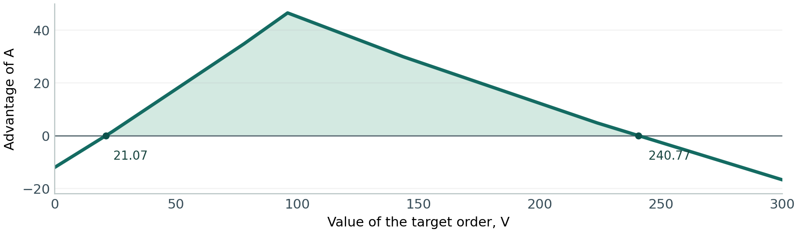
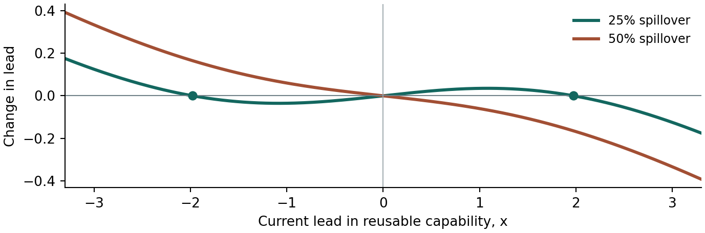

# Choosing the First Deployment

[PDF edition](Choosing_the_First_Deployment.pdf) · [Replication and reading guide](README.md)

## What does the firm allocate?

*Autonomous Firm Theory  /  Allocation*

A theory of how a firm commits scarce capacity when doing the work also changes what its agents can learn and do next.

> The unit of allocation is a feasible plan for using capacity over time. “Give an operator an hour at A” is an incomplete description. Its value depends on what the operator could otherwise do, what the hour might reveal, and who could use that evidence before it expires.

### Four primitives

**1. Work and payoffs.** A task has a customer, an acceptance condition and a deadline. Completed work earns the contribution the firm can capture. A faster robot changes that contribution if it affects accepted throughput, cost, or the price the customer will pay. An internal charge moves money between units and cancels at the firm level.

**2. Feasible combinations.** Specify which agent, embodiment, operator, compute and permissions a plan needs, where, and in which window. An operator today and validation compute tomorrow can be complements. An unrelated inference job tomorrow can compete for that same compute. Competition for capacity and transfer of learning are different relationships between tasks.

**3. Information and authority.** Each decision belongs to someone who can observe particular signals and commit particular inputs before a deadline. A plan may say “validate if the trace is informative and the queue is light” only if an authorized actor can learn both facts in time. Delegation or a contingent contract can change this feasible set.

**4. State transitions.** A choice produces work, selects the observations the firm will see, and can alter the policy, hardware or procedures available next time. Distinguish a change in the firm’s belief about a gripper from a retrofit that physically changes its reach. Both can change the next decision through different channels.

### The governing comparison

Q(s, a) = E[π + β J(s′) | s, a]     J(s) = max over feasible a of Q(s, a)

Here s records payoff-relevant productive capacity, outstanding commitments and beliefs. A choice a is a feasible joint plan up to the next decision, including who can respond to which signal. π is net contribution over that interval. J is the value of reallocating optimally thereafter. To value a commitment, compare the best plan requiring it with the best plan excluding it. Both comparisons allow the rest of the firm to adapt. A forecast of future orders enters once through the payoffs it changes.

This is a normative benchmark. The empirical question is which constraints and transitions explain observed choices. The deployment study that follows uses its own page numbering.

## When the timing of scarcity changes the answer

*Allocation  /  A derived implication*

Two firms can have identical demand, robots, error rates, teleoperator costs and available compute, yet rationally collect different data.

An operator can handle a paying job today or sample a fault at site A. Sampling gives up k in contribution. With probability one half it yields a usable trace (I = 1). Tomorrow, validating that trace delivers target contribution v by the deadline. It consumes a slot otherwise earning X on another job. Without a trace the other job runs. The authorized scheduler observes I and X before committing the slot. All amounts are in present-value units.

Gain from sampling = E[I × max(v − X, 0)] − k

Suppose k = 7, v = 24, and the alternative job earns either 2 or 18 with equal probability. The slot is always worth using when there is a trace. The two schedules differ solely in which state coincides with a usable trace.

| Timing of useful traces | Alternative displaced when I = 1 | Gain from sampling | Allocate operator to |
| --- | --- | --- | --- |
| All arrive in quiet windows | 2 | ½(24 − 2) − 7 = +4 | Sampling |
| Timing is independent | 10 on average | ½(24 − 10) − 7 = 0 | Either use |
| All arrive in busy windows | 18 | ½(24 − 18) − 7 = −4 | Paying job |

### Why a site-level score misses the reversal

In this range the gain is Pr(I = 1) × (v − E[X]) − Cov(I, X) − k. A score built from average transfer yield, average compute utilization and target value gives zero in all three rows. The omitted covariance gives the entire ranking here. With higher congestion the option to decline validation also matters. The positive-part formula continues to hold when the covariance shortcut fails.

An operating prediction follows. Retiming an unrelated batch job, without adding compute or improving the model, can make a previously rejected demonstration worth collecting. The prediction requires a shared, deadline-bound slot. If traces can wait costlessly until spare capacity arrives, the relevant alternative is whatever that later slot would displace. The immediate congestion effect can disappear.

### A test at the level of the firm

Randomize and announce eligible batch-job schedules before sampling decisions, holding total capacity and booked work fixed. Record the trace yield with occasional assigned sampling shifts, including windows the controller would normally skip. Then observe its discretionary sampling choices, accepted target work and displaced jobs. This tests a change in the allocation ranking and the firm-wide contribution it predicts. Samples gathered only on chosen shifts would confound the decision with the evidence used to evaluate it.

## How allocation produces firm differences

*Allocation  /  Organizational implications*

A price concession, a persistent deployment route and a valuable routine can all arise from the same allocation rule.

### Decision rights can reverse an investment

In a variant of the timing example, take v = 12, k = 2 and let trace arrival be independent of the queue. If an authorized scheduler sees the queue, it validates only in a quiet window. Sampling earns ¼ × (12 − 2) − 2 = +0.50. If the validator must commit upon receiving a trace, before seeing the queue, validation then earns 12 − 10 = 2 on average. Ex ante, sampling earns ½ × 2 − 2 = −1. The firm allocates the operator elsewhere. A timely message and the power to act on it can therefore induce upstream data collection with exactly the same machines and staff.

### Three mechanisms emerge at different timescales

**Within a window,** relative advantage depends on the best use of shared inputs. A shift in queue timing changes what the firm should sample even if every model’s accuracy is fixed. A scalar price for a slot can coordinate this example if it conveys the actual displaced value in time and the local agent also receives credit for downstream gains.

**Across orders,** customer demand changes the payoff to a successful transfer. The deployment study derives the sequence from routine work, to a source pilot, to direct entry. The last switch requires a more reliable direct route and competition for a launch slot. Firms with ample launch capacity can pursue both routes.

**Across cohorts,** the allocation can change the transition that governs later allocations. Maintaining a capture routine raises the yield of the next operator-hour. If the firm can profit from that yield, it may spend another hour maintaining the routine. Depreciation, weak transfer or a better outside job can end this feedback. The study’s two-state example gives a finite period of persistence after a demand shock.

### When a resource-based theory becomes warranted

Start two firms with the same purchasable inputs and opportunities. Vary an earlier allocation, then equalize demand and current budgets. Which retained difference still changes the set of profitable plans? For a capture routine, measure its effect on trace yield, remove or restore it, and re-optimize the whole firm in each case. Its economic value is the resulting difference in attainable profit. Durable private advantage requires an additional account of control, replication cost and who captures the gain. A temporary congestion price can govern allocation without becoming an accumulated resource.

This yields a candidate firm-specific resource only if the retained difference survives into a new decision. It is endogenous if earlier choices helped form it and heterogeneous if firms facing the same opportunity inherit different levels. Two complementary routines may be valuable only together. Their separately measured marginal values need not add up to the value of the pair.

Intellectual antecedents. Koopmans develops production as combinations of activities. Marschak and Radner make information and decision functions features of organization. Penrose connects inherited resources to the productive services a firm can render. The timing test and the numerical comparisons here are illustrative deductions.

[Activity Analysis of Production and Allocation](https://cowles.yale.edu/research/cfm-13-activity-analysis-production-and-allocation)  ·  [Economic Theory of Teams](https://cowles.yale.edu/research/cfm-22-economic-theory-teams)  ·  [The Theory of the Growth of the Firm](https://academic.oup.com/book/25306/1000)

## Choosing the First Deployment

*Deployment economics*

How demand in one market changes the price of robot work in another

> A customer can become more valuable to a robotics firm even while its factory, orders and labor costs stay the same. Its production line teaches a recovery that another customer now has more reason to buy.

Imagine a packaging line where a teleoperator occasionally recovers a carton whose flaps have folded inward. A second customer handles different goods but encounters the same fault. Tomorrow’s order at the second plant changes the value of observing that recovery today. At a sufficiently large order, it can reverse the deployment sequence altogether. The firm takes its engineers straight to the second plant.

### From robot productivity to demand

At a customer site, the marginal product of robot capital is the extra accepted output from another unit of installed robot capacity, given the crew, line and work available. For a short-run quote, the relevant increment may be one more operating hour on an installed cell. Faster picks create little throughput value if the packer is already full. Covering a missing shift can unlock an entire shipment.

The most the customer would pay for a block of service is its incremental operating profit against its best feasible alternative, measured before the robot fee. Count additional saleable units at contribution margin, labor expense actually avoided or the value of labor redeployed, and changes in rework and downtime. Count each gain once. A deployer that charges below that ceiling leaves the customer a reason to expand volume. The resulting workload determines which events the robot encounters.

### One launch slot, three uses

Let A be the packaging site, B the target market, and C a routine deployment. The firm has one launch team for this window. At A it chooses q blocks of service at a uniform price p(q). Its current contribution is m(q). With probability g(q), the experience qualifies a reusable policy at B by the order deadline. Let V be the firm’s discounted contribution from a qualified B order, net of serving it. Going directly to B qualifies it with certainty at one-time cost F. Routine site C yields K.

Value of A = maxq { m(q) + g(q)V } Value of direct B = V − F      Value of C = K

The firm chooses the highest feasible value, including zero for waiting. Both routes to B serve the same order on the same terms. Choosing C or waiting lets this order expire. If the firm can still launch B after a failed A pilot, the fallback belongs in A’s value. Adding the whole B order to both the transfer gain and that fallback would count it twice.

## When the learning site loses its place

*Proposition  /  Site sequencing*

The order can move from an ordinary deployment, to the learning site, to the target market itself.

**Proposition.** Suppose feasible pilot sizes are finite and each has a positive chance of qualifying B, strictly below the direct route’s chance. As V rises, A gains against C and loses ground against direct B. If A is strictly best for any V, the values of V for which it wins form one interval. Inside it, if larger pilots are more likely to qualify B, the optimal pilot size weakly increases. With downward-sloping demand, the offered unit price weakly falls.

**Derivation.** Each A plan has value m(q) + g(q)V. Every such line rises faster than the flat payoff K and more slowly than direct entry. The best A plan inherits both comparisons. Comparing two quantities, the larger pilot’s advantage rises by the difference in their qualification probabilities per extra unit of V. A quantity switch therefore favors the larger pilot as V rises.

### A worked deployment decision

All figures are illustrative currency units. Set K = 76, F = 20 and p(q) = 24 − q for 1 through 12 blocks. Each block costs 8 and independently has a 10% chance of producing a recovery that passes the target test. One qualifying recovery suffices. Then m(q) = q(16 − q) and g(q) = 1 − 0.9q. Assume cross-site training rights and include collection, training and validation in the block cost.

Figure 1. Expected contribution from starting at A minus the better of C and direct B. Above zero, A wins. The kink at V = 96 occurs when direct B overtakes C as the alternative use of the launch team.

| Target value V | Best first site | Blocks sold at A | Unit price at A | Firm value |
| --- | --- | --- | --- | --- |
| 0 | C | — | — | 76.00 |
| 22 | A | 8 | 16 | 76.53 |
| 100 | A | 10 | 14 | 125.13 |
| 250 | Direct B | — | — | 230.00 |

A first ties C at V = 21.07. The first price cut comes later, at V = 23.23, when a ninth block earns its place. At V = 240.77 even the largest pilot’s remaining chance of missing the order outweighs A’s current margin plus the direct qualification cost saved. Above that point A loses the launch slot.

## What the firm has to learn

*Implications  /  Empirical design*

The uncertain quantity is the gain at a particular target from the next block of source work.

### Price an encounter, then choose how to obtain it

For a differentiable interior choice with per-block cost c, the pricing condition is p(q) + q p′(q) = c − Vg′(q). The term Vg′(q) is what the firm would give up in immediate contribution for the extra chance of qualifying B. It can justify a volume discount at A even when A’s own productivity has stayed flat. If a discount fills the schedule with familiar cartons, g′ can be close to zero. Buying a targeted operator demonstration or a simulator run may then earn more than discounting a whole shift.

In a fleet, g depends on which failures recur, who can correct them, available training and inference compute, and compatibility with the target embodiment. A logged intervention that cannot be reused or validated by the deadline may have considerable local service value and zero value for this B order. A change in gripper geometry may beat collecting another thousand examples. These alternatives belong in the same budget at the time each input is needed.

### Where organizational inventiveness enters

Give two firms identical robots, policies and budgets. One sends every exception to a rescue queue. At the other, agents can reserve operator time, sample a particular fault at A, test the update at B and reassign the launch team. The firm retains both the carton policy and the procedure for deciding which fault deserves a demonstration. The second asset has a distinct test. Give both firms an unfamiliar pair of sites and the same starting policy and budget. Does the revised procedure choose experiments that deliver more accepted work per dollar?

### A test that could reject the mechanism

Use a B-only change in booked orders or an externally set order deadline. Track the full menu of candidate sites, including lost bids and unused slots. Estimate transferable lift from held-out B runs with and without A examples at matched compute, task mix and hardware. Record accepted throughput, operator minutes, displaced launch work and realized contribution. Compare source sites with similar local demand but different measured transfer to B.

A moderate B shock can lower A’s price or move A ahead of C. A larger shock can move the team directly to B. Comparable discounts at sites with no reusable transfer would favor another explanation, such as a common demand shock. An extra launch team should weaken the competition between routes.

### Research antecedents

**1** [Farboodi, Koh & Xia · Data-Driven Automation (2026)](https://www.nber.org/papers/w35320). Models task-specific data produced by economic activity and spillovers across tasks.

**2** [Open X-Embodiment Collaboration · RT-X models (2023)](https://arxiv.org/abs/2310.08864). Demonstrates positive cross-robot transfer in tested settings. A commercial qualification rate still requires site-level evidence.

**3** [Spence · The Learning Curve and Competition (1981)](https://www.gsb.stanford.edu/faculty-research/publications/learning-curve-competition). Develops the economics of output and learning. Here the deployment decision also includes direct qualification at the destination.

## When demand changes what the firm can learn

*Extension  /  Conjecture*

Two launch teams can face identical orders and rationally choose opposite sites because their earlier deployments changed what each team can learn in a shift.

> Conjecture. When deployments build a reusable way to collect target-relevant evidence, a temporary order at B can change the firm’s choice of site after the order expires. A large enough order can interrupt the very learning process that a smaller order would sustain.

### What survives a deployment?

Suppose every launch window brings a fresh carton variant at B. Each requires a new acceptance test. A capture routine at A synchronizes the operator’s correction with camera frames from just before a jam. The routine can carry across variants even when the correction itself cannot. Teams that use it have occasions to fix a misaligned camera or update a trigger. Idle routines can fall behind changing equipment. A direct launch at B solves that order locally.

Call the capture routine **ready** if a standard test confirms it works and **unready** otherwise. Freeze the execution policy, hardware and training budget across teams. Retain the margins, prices and 12-block limit on page 2. Assume each block at A independently qualifies the current B order with probability .12 when ready and .06 otherwise. The next routine state depends on the route, with probabilities below. These are illustrative assumptions about maintenance and discovery.

| Current routine | Ready next window after A | Ready next window after B or C |
| --- | --- | --- |
| Unready | 25% | 0% |
| Ready | 95% | 65% |

### The decision has two distinct payoffs from learning

Let Δ be next window’s expected lifetime profit when ready minus that when unready. At a discount factor of .90, A’s advantage over the best other site equals its current advantage plus .90 × Δ × the extra probability of readiness from choosing A. Current advantage includes any B order qualified this window. Δ starts with the next order. This timing separates the value of a reusable collection method from the value of the specific policy it helped qualify.

With future orders worth 250 each, the stationary solution gives Δ = 97.12. An unready team goes directly to B each window and earns 230. A ready team chooses 12 blocks at A, earns 244.08 in expectation this window and stays ready with probability .95. Subtracting the two lifetime values gives Δ = 14.08 / (1 − .90 × .95), up to rounding. Checking the alternative actions gives the strict choices on the next page.

## After the order expires

*Extension  /  Predictions and identification*

A one-window change in demand separates the value of today’s job from the ability to learn on tomorrow’s.

Let only the current B order vary. Both teams know future orders return to 250. Each cell below is A’s advantage over the best alternative, including continuation value. Positive means launch at A. The final column gives the next-window chance of choosing A for a team starting unready / ready. At the common future demand of 250, only a ready team chooses A.

| B order now | A advantage if unready | A advantage if ready | Sites chosen now¹ | A next window¹ |
| --- | --- | --- | --- | --- |
| 0 | +9.85 | +14.22 | A / A | 25% / 95% |
| 100 | +47.99 | +78.37 | A / A | 25% / 95% |
| 250 | −29.13 | +40.30 | B / A | 0% / 95% |
| 500 | −148.11 | −13.61 | B / B | 0% / 65% |

¹ Ordered as initially unready / ready. Values use all 12 possible A volumes and both outside sites. At V = 0, C is the best outside site. At the other values, direct B is the best outside site.

### Two observations that the one-order model misses

**A firm may pay to practice during a demand lull.** At zero current B demand, A earns 64 on its own work and C earns 76. An unready firm gives up 12 to buy a 25% chance of having a better sampling method next window. The discounted gain is 21.85. A lull can therefore be a good time to build the capacity that a busy launch calendar consumes.

**The effect survives the shock and decays.** Compare two initially ready teams. One receives a B order worth 500 this window, the other 250. Next window both face 250. The first is 30 percentage points less likely to choose A. One window later the gap is 28.5 points. After k more ordinary windows the original gap is multiplied by .95k. Both teams eventually lose readiness here because an unready team at 250 never rebuilds. The model generates persistence with a finite expected duration.

### How to distinguish learning from customer inertia

Hold initial readiness fixed and use a B-specific order shock with a known expiry. After demand normalizes, give teams the same previously unseen carton variant, execution policy, operator hours and training compute. Measure usable pre-jam traces per shift, qualification on held-out B cartons and the next site chosen. A shift in deployment alone could reflect installation costs or contract renewal. A change in trace yield and transfer on the common test is the additional prediction.

A sharper intervention restores the capture routine to a random subset of interrupted teams before the next decision. The predicted route gap shrinks as measured readiness converges. If direct launches maintain the routine equally well, the continuation premium from choosing A vanishes. If restoring readiness fixes trace yield but leaves the entire deployment gap intact, another mechanism is governing site choice.

## Which decisions can the firm delegate?

*Competition  /  Degrees of autonomy*

A firm’s economic degree of autonomy depends on which decisions its agents can commit in time, and which of those decisions alter the choices available later.

> The conjecture is conditional. Expanding an agent’s authority creates private value where it changes a binding allocation. Rival access to the same capability then determines whether that value becomes supplier profit, a customer discount, or a higher price for a scarce input.

Describe each business unit by its effective authority over execution, shared capacity, deployment of learned policies, and revision of its own allocation procedures. Record the horizon, budget, information and human approval delay for each. Describe hardware ownership, data rights, and access to customers separately. An outsourced fleet can possess extensive authority under contract. An integrated fleet can require human signoff for every update.

| Configuration | Decision agents can commit | Economic margin exposed to competition |
| --- | --- | --- |
| Human-directed | Agents recommend. A person authorizes the consequential change. | Can match any feasible automated action if review is timely. Scarce human attention can make opportunities expire. |
| Execution autonomy | Choose actions inside an assigned job and envelope. | Competes on accepted throughput and reliability. Extra local speed earns little on a line constrained downstream. |
| Allocation autonomy | Move people, compute and machines between jobs as signals arrive. | Can exploit slack or reassign a rescue slot. Advantage depends on competing jobs, deadlines and visibility. |
| Learning autonomy | Also select evidence, train and validate, then release a policy to eligible sites. | Can bid for the future use of a deployment. Transfer rights, target demand and validation capacity govern that bid. |
| Recursive autonomy | Also revise and retain the procedure for choosing experiments, budgets or routes, within a mandate. | Can change the yield of later learning investment on unfamiliar tasks. Procedure design consumes production capacity today. |

These are benchmark configurations. A physical unit may have execution authority only, while its digital sibling can retrain a model but cannot move the GPU reservation. Such firms are only partially ordered. A broader, costless feasible menu weakly increases the firm’s best payoff with rivals held fixed, since it can repeat its old plan. Fees, errors, irreversible delegation and rival responses can reverse realized profit.

Information and effective authority have an established treatment in team theory and Aghion & Tirole [C1]. The distinctions here specify which state transitions a field researcher would have to observe.

## What a deployment is worth to a bidder

*Competition  /  From allocation to rivalry*

A competitive allocation values the next joint state of the firms. The losing bidder also has a continuation payoff.

Write Jᵢ(s) for firm i’s discounted profit given current capabilities, workload, input access and rivals’ strategies. Winning site A costs cᵢ in incremental service and displaced work this period. Let Wᵢ and Lᵢ be its discounted continuation values if it wins and if its rival wins. Each route lets it reallocate its remaining assets. For a single award at fee p, with comparable service, its advantage from winning is

p − cᵢ + Wᵢ − Lᵢ.       Break-even fee: bᵢ = cᵢ − (Wᵢ − Lᵢ).

A firm with reliable operations but little learning authority can have a low cᵢ. A firm with a costly first installation can have a larger Wᵢ − Lᵢ because it converts errors at A into accepted work on B. The second wins on effective cost when its extra continuation gain exceeds its service-cost disadvantage. An expiring compute reservation or an inability to pay for today’s installation can eliminate that advantage.

### Four orders of effect, with a counterfactual at each step

| Order | What changes | Counterfactual |
| --- | --- | --- |
| 1 · Allocation | A signal moves an operator or compute slot to a different job. | Keep rival behavior and the firm’s capabilities fixed. Which accepted job changes? |
| 2 · Accumulation | The job changes a policy, routine, or the future set of feasible experiments. | Hold future budgets and demand fixed. Which future jobs or experiments can now succeed? |
| 3 · Competitive response | Bids, rival investment, or the location of the next deployment respond. | Let competitors revise their choices. Who obtains the next order and how much of the gain reaches the buyer? |
| 4 · Industry adjustment | Repeated awards change capability shares, input prices, entry or firm boundaries. | Allow access and stocks to evolve. Does a shock decay, change who invests, or persist through future awards? |

With two suppliers, a mandatory award and a reverse second-price auction, the lower break-even bid wins and receives the other bid. Assume known incremental values independent of the payment. Losing always awards the site to the same rival. With several rival identities, refusal to award, or information inferred from bids, the losing state must be modeled explicitly.

Distinguish productive transfer from preventing a rival from learning. Either can raise Wᵢ − Lᵢ. Only productive transfer directly creates extra accepted output. A low fee alone cannot identify the channel. Look for held-out target gains and the counterfactual outcome when both suppliers can use the evidence.

## When upgrading both firms lowers their profits

*Third order  /  Investment and capture*

An exact procurement game separates the return to a capability from the return to owning it in a competitive market.

Two equally reliable firms can each serve the current customer for 30. Before bidding, each can spend 3 to acquire the authority and validation process needed to reuse the site’s experience. An upgraded winner realizes 8 in genuine discounted savings on separate future work. The loser gets zero incremental savings. A buyer awards one site by reverse second-price auction. Both firms know the rules and costs. Normalize buyer surplus at fee 30 to zero.

| Investment before bidding | Fee paid | Supplier 1 profit | Supplier 2 profit | Buyer gain |
| --- | --- | --- | --- | --- |
| Neither upgrades | 30 | 0 | 0 | 0 |
| Only firm 1 upgrades | 30 | 5 | 0 | 0 |
| Only firm 2 upgrades | 30 | 0 | 5 | 0 |
| Both upgrade | 22 | −3 | −3 | 8 |

Break-even bids are 30 and 22. A sole upgrader wins and is paid 30. If both upgrade, either can win at 22, and the winner’s 8 in later savings offsets its 8 operating loss on this site. Both incurred the investment cost. Joint social gain relative to neither upgrading is 5 with one upgrade and 2 with two. These totals count the real costs and savings once.

### A heterogeneous industry can emerge from identical firms

There are two pure investment equilibria. Exactly one firm upgrades in each. If the rival abstains, upgrading gains 5. If the rival upgrades, abstaining earns zero while matching loses 3. In the symmetric mixed equilibrium each upgrades with probability 5/8, obtained from 8 × Pr(rival abstains) = 3. Duplicated investment and occasional failure to invest are possible even though one upgrade maximizes joint surplus.

The both-upgrade outcome describes what happens after simultaneous sunk commitments, as can occur under mixed strategies. It is not a pure equilibrium. A recurring portfolio of other sources changes the comparison. If an upgrade also earns a guaranteed private return exceeding 3 on independent work, upgrading becomes individually profitable even when the rival matches. This gives a portfolio deployer and a single-site specialist different adoption incentives.

### Observable distinction

When a second credible learning-capable bidder enters, the fee can fall although the incumbent’s cost, policy and technical performance stay fixed. A matched procurement in which neither supplier may reuse the data should lose this particular price effect. Learning-based competition is established in industrial organization [C2]. The objects to estimate here are the downstream return, its exclusivity and the cost of acquiring authority.

## When the weaker learner wins the site

*Third to fourth order  /  Two linked markets*

Solving both procurements shows how a firm’s opportunity cost can depend more on its rival’s learning than its own.

Source customer A and target customer B each award one mandatory, exclusive job by reverse second-price auction. The same two qualified suppliers bid at both dates. Each incurs 30 to serve A and initially costs 20 at B. Reducing B’s cost by 8 qualifies a better production method. Outside the source deployment, each independently discovers that method with probability h. The learning-capable supplier additionally discovers it with certainty if it wins A. The execution-only rival has no such route. All facts are common knowledge, future value is undiscounted, offers at A cannot depend on the outcome at B, and B costs are observable before its auction.

At B, either firm earns 8 if it alone discovers the method, and zero in every other case. Bid the execution-only rival out of A and the learner’s own chance of discovery rises from h to one. That improvement earns a rent only if the rival also fails to discover independently. Conversely, the execution-only firm can win A to preserve its chance of being the sole low-cost bidder at B.

Learner’s gain from winning A = 8(1 − h)². Execution-only rival’s gain from winning A = 8h(1 − h).

For example, if the learner wins A, its expected B profit is 8(1 − h) and its rival earns zero. If the execution-only firm wins A, both rely on independent discovery and each earns 8h(1 − h). Subtraction gives the two gains. Each subtracts its gain from 30 to set its first bid.

| Independent discovery h | Learner bid | Execution-only bid | A winner / fee | Expected real saving at B |
| --- | --- | --- | --- | --- |
| 25% | 25.50 | 28.50 | Learner / 28.50 | 8.00 |
| 75% | 29.50 | 28.50 | Execution-only / 29.50 | 7.50 |

**Threshold.** For 0 < h < ½ the learner wins. For ½ < h < 1 the rival wins even though its own probability of learning is identical whether it wins or loses. If the rival wins, the chance neither discovers the method is (1 − h)². At h = .75 the order therefore goes to a firm whose selection forgoes .50 in expected real savings. A receiving customer optimizes its own procurement. A and B need not share in the gains in the same proportions.

**Boundary and test.** If both firms can access the same source traces independent of the A award, and winning conveys no other target advantage, both strategic bid discounts vanish. Compare exclusive and nonexclusive access at the same transfer yield and service quality. The model predicts a change in the weaker learner’s bid even when its own held-out task performance never changes. Independent validation can identify whether h actually lies above the threshold.

## When winning work compounds a lead

*Fourth order  /  Endogenous industry structure*

Competition that dissipates a margin on one contract can still concentrate future deployments. These are separate propositions.

Consider a market with many small awards per period. Let x be the difference between two firms’ reusable capability stocks. The first wins share P(x) = 1/(1 + exp(−κx)), with κ > 0 measuring sensitivity of awards to capability after price and quality responses. Each unit of awards creates r units of capability for its winner. The rival absorbs a fraction σ of that learning. Both stocks depreciate at rate δ each period. This is a deterministic aggregate model with a reduced-form award share, separate from the auction game.

Next lead = (1 − δ)x + r(1 − σ)[2P(x) − 1].

Near equal shares, a small lead grows if r(1 − σ)κ/2 > δ and shrinks if the inequality reverses. The left side is the extra differential learning caused by one more unit of lead. For 0 < δ < 1, the logistic response saturates. Above the threshold there are two stable asymmetric fixed points and an unstable symmetric one. This follows because 2P(x) − 1 = tanh(κx/2) is odd, increasing, bounded and strictly concave for positive x.

Illustrative parameters r = 1, κ = .8, δ = .25. At σ = .25, a small lead is multiplied by 1.05 and the stable winner share is about 83%. At σ = .50, the multiplier is .95 and shares converge to equality. Exactly equal firms remain equal until a perturbation. The diagram plots changes per period.

**Why autonomy enters.** Authority over sampling and validation can increase r. A process that transfers across customers can raise κ if it changes delivered reliability or price. A common upstream model that absorbs everyone’s traces can raise σ. Correlated failure or installation bottlenecks can lower r. Each quantity requires measurement. No autonomy category mechanically implies concentration.

A mature operator can also exhaust the useful variation at its sites. In a task family where its marginal r falls, an entrant with access to rare but transferable failures can catch up. Strong within-task feedback and weak between-task transfer instead predict separate leaders by task family. These are extensions beyond the symmetric constant-r proof. Earlier dynamic industry models also show how learning and forgetting affect dominance [C3].

## Where the return goes when everyone can learn

*Fourth order  /  Common inputs*

Firms can become better at identifying the same valuable experiment and thereby raise the value of the input they all need next.

Two firms each generate a candidate that is worth 12 if validated before expiry. Each has a candidate with probability one half. They share one validation slot. No validation is needed when both lack candidates. All candidates are equally valuable. Hold total compute, candidate quality and each firm’s hit rate fixed. Vary only how often the two candidates arrive together.

| Candidate arrival | Expected candidates | Value with one slot | Value of a second slot |
| --- | --- | --- | --- |
| Independent | 1 | 12 × ¾ = 9 | 12 × ¼ = 3 |
| Perfectly synchronized | 1 | 12 × ½ = 6 | 12 × ½ = 6 |

At a real cost of 4 per period for a second slot, adding capacity destroys 1 of joint surplus under independence and creates 2 under synchronization. A common allocation model, deadline or bulk data release could synchronize demand. That causal link is a conjecture. The capacity values follow exactly given either arrival law.

Who gets paid depends on the institution. An upstream supplier able to price an exclusive slot when both candidates arrive may collect the scarcity rent. Under a fixed-price compute contract, a deployer with priority can retain it. With substitutable slots available on demand at marginal cost, the premium is bounded by that substitute. Nominal autonomy alone determines none of this incidence.

### Responses available at different organizational margins

**Execution:** shorten validation or make the robot less reliant on rescue. **Allocation:** stagger deadlines or redirect work across slots. **Learning:** change which source failures get sampled so their useful traces arrive at different times. **Recursion:** revise the experiment-selection procedure to penalize collisions across projects, then test whether it generalizes to new facilities. A human-directed business can implement the same policy if it can observe, authorize and act in time.

This makes a physical retrofit an economic substitute for a digital scheduling change in some states. A new sensor that removes peak-time validation requests can earn more than a larger average accuracy gain on quiet shifts. Compare either option with the firm’s best external capacity contract, including queue priority, fallback and deadline risk.

Labor incidence can reverse too. If N deployed hours each require h operator-hours, total intervention labor is Nh. Falling h can coexist with rising labor demand if N grows faster than h falls in proportional terms. Whether operators capture learning rents depends on scarcity, bargaining and reuse rights. The participation wage alone does not measure the fleet value of a demonstration.

## Which differences become firm resources?

*Fourth order  /  Firm boundaries*

An inherited difference becomes economically relevant when it changes the return to a feasible future plan. A durable rent needs further conditions.

| Candidate object | Formation and economic unit | What can erode or transfer the return? |
| --- | --- | --- |
| Task and embodiment coverage | Past deployment builds evidence about which source fault improves accepted target work per operator-hour at a given compute budget. | Target mix shifts, policy obsolescence, a simulation substitute or a rival’s access to the same traces. |
| Contingent capacity rights | A priority right buys the ability to reserve one specific slot when other uses are valuable. | New supply, enforceable sharing, lower correlation, or expiry. A purchased right can matter without being internally created. |
| Retained allocation procedure | Earlier experiments improve the choice of future experiments. Measure incremental net contribution on unfamiliar tasks with matched starting assets. | Imitation, staff turnover, software diffusion, or a new constraint that the procedure never learned to price. |
| Physical complements | A retrofit or installed interface changes accepted throughput, reach or trace yield at a specific site. | Replication, modular hardware, redeployment costs or a bottleneck elsewhere on the line. |

Let J be attainable profit after re-optimizing every affected business unit. The productive value of one inherited object z is J(with z) − J(without z) under specified rival policies and access terms. For a competitive rent comparison, let rivals and input suppliers respond and deduct acquisition, maintenance and replacement costs once. Complementary objects require a joint removal test. Reporting every individual removal loss as a separate asset value can count the same bottleneck repeatedly.

### Make, buy or share the learning loop

Compare three feasible organizations over the same horizon. Integration pays for hardware, coordination and retained access. A contracted network pays for equivalent observation, reuse, timely validation and deployment rights where those can be written and enforced. An open network pools evidence and may improve every participant’s productivity while shrinking private bid differences. Each comparison uses the best feasible policy under that arrangement, including counterparties’ responses.

A full-stack firm has a reason to integrate when the additional captured surplus from earlier contingent decisions, retained rights or complementary investment exceeds its incremental governance and capital cost. A specialist can outperform it where off-the-shelf capacity is cheap, a niche supplies unusually valuable evidence, or integration ties up the scarce launch team. Financial capital can buy another cell immediately if one is for sale. A history-dependent capture procedure may still require ordered trials and validation time. Replication speed and appropriability determine how long the distinction matters [C4, C5].

## What would distinguish the mechanisms?

*Empirical program  /  Identification*

Follow the same allocation from signal and authorization, through accepted work, to the rival’s next bid and the next change in capacity.

| Mechanism | Variation and outcome | Evidence that weakens the account |
| --- | --- | --- |
| Timely authority | Randomize a preauthorized budget or approval window across comparable queues. Hold the model fixed. Track expiry, feasible actions, accepted work and displaced jobs. | The decision set expands on paper but nothing becomes executable before expiry, or gains disappear after counting displaced jobs. |
| Recursive capacity | Randomly retain or restore a revised selection procedure. Start new site pairs with the same execution model, corpus, hardware, rights and learning budget. Track net gains over repeated cohorts. | The entire advantage disappears on fresh tasks, or equivalent gains follow from deploying the old selector with the updated execution model. |
| Competitive pass-through | Use an externally induced second qualified bidder or a rights change. Compare reusable and restricted jobs. Observe offers, winners, later savings and the buyer’s alternative. | Similar price moves on sites with no transferable gains point to ordinary cost competition or a common demand shock. |
| Compounding advantage | Estimate conversion r from assigned source work, σ from controlled cross-firm access, κ from award changes and δ from decay. Test predicted response to a temporary lead out of sample. | Shares remain equally persistent where measured feedback is weak, after accounting for quality, switching costs, supply limits and customer lock-in. |
| Rent migration | Stagger release times across markets sharing a validator. Measure overlap, displaced work, slot bids and incremental capacity investment. | Capacity spending and prices change equally in uncongested comparison pools despite matched demand. |

Use the unit appropriate to each order: decision window for allocation, deployment cohort for transfer, competing bidder set for price, and task family or shared pool for industry structure. Record rejected sites and unsuccessful experiments. Randomizing one firm can change a rival’s opportunities. Where spillovers matter, randomize at pool or market level, or estimate the exposure of untreated firms explicitly.

Report accepted work, real input costs, and who receives the residual. A price cut can accompany a productivity gain. Exclusivity can raise supplier profit without increasing output.

### A quantitative hurdle for recursive autonomy

Redesign costs 12 and raises acceptance probability by .20 per eligible cohort. An acceptance creates 40. Extra validation costs 1 per cohort. At 50% capture, each cohort earns .20 × 40 × .50 − 1 = 3. The firm needs more than four discounted cohort equivalents to justify redesign. At 10% capture, using the revision loses .20 per cohort. Count only tasks reachable with the required rights and hardware, holding the execution policy fixed.

## A conditional theory of competitive advantage

*Synthesis  /  Scope and antecedents*

The propositions describe different adjustments to the firm’s allocation. Their interaction is an empirical question.

> A firm accumulates technocapital when an allocation leaves it able to execute better future plans. It earns a durable competitive return only to the extent that the improvement survives, changes valuable choices, and remains scarce after customers, competitors and input suppliers respond.

The price game derives strategic substitution in adoption from a single contestable site. The linked procurement game solves both markets backward and allows the weaker learner to win for a strategic reason. The stock model derives reinforcement from many awards with private learning. The capacity example derives a change in the value of a common complement from synchronized demand. Each is solved conditional on its own assumptions. They specify compatible margins for a larger industry model. They do not establish that one equilibrium will exhibit all three effects.

### What would a joint model have to close?

Firms would choose procurement bids, exploration, model updates and adoption together. Customer demand would respond to price and accepted throughput. Input suppliers would choose capacity and access terms. Resource stocks and rival access would transition with the resulting deployments. For a given initial state, compare surplus and incidence across equilibria, or specify a selection rule. Until then, the direction of market concentration, aggregate labor demand and the full-stack premium remain conditional.

### Research antecedents

**C1** [Aghion & Tirole (1997) · Formal and Real Authority in Organizations](https://doi.org/10.1086/262063). Distinguishes formal authority from effective control. Here the measurable margin is which contingent allocation can actually be completed in time.

**C2** [Cabral & Riordan (1994) · The Learning Curve, Market Dominance, and Predatory Pricing](https://ideas.repec.org/a/ecm/emetrp/v62y1994i5p1115-40.html). Studies strategic pricing with learning in a differentiated duopoly. Our auction isolates how competing learning capacity can pass value to the customer.

**C3** [Besanko et al. (2010) · Learning-by-Doing, Organizational Forgetting, and Industry Dynamics](https://repository.upenn.edu/bitstreams/b50e087d-fddb-44e0-8f34-f8ece6f7a8d2/download). Develops a dynamic industry model of learning and forgetting. The threshold above is a distinct reduced-form derivation.

**C4** [Dierickx & Cool (1989) · Asset Stock Accumulation and Sustainability of Competitive Advantage](https://doi.org/10.1287/mnsc.35.12.1504). Links imitability to the way stocks accumulate and erode. Here one candidate stock changes the yield of future experimentation.

**C5** [Teece (1986) · Profiting from Technological Innovation](https://doi.org/10.1016/0048-7333(86)90027-2). Studies appropriability and complementary assets. The scarce validation slot provides a numerical example of a complement whose value changes with competition for time.
