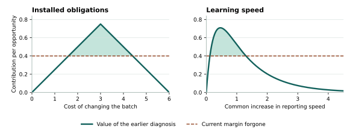

# Archived source edition — Paper 2 consolidation

This is preserved supporting text, not an independently evolving paper. The sole active manuscript is [The Autonomous and Full-Stack Firm](The_Production_of_Capability.md). [Source-to-section routing](../../research/portfolio/CANON.md#paper-2-one-manuscript-five-results) sends financing/disclosure to Paper 1 and organizational recursion, scaling and dynamic boundaries to Paper 3. Existing proofs, links, scripts, counterexamples and empirical limitations remain valid only within their original scope. Old packaging dates are provenance, not deadlines.

---

# The full-stack robotic firm

*How deployment selects the next machine · The Production of Capability · November 25, 2026*

A robotics firm can put its next machine on a packaging line it already understands or on a less profitable line where flexible packages slip unpredictably. The second customer may teach it whether to change the gripper or the control policy. If the factory must order the next gripper before the result arrives, that lesson has a different use. It may still improve a deployed policy. It can affect the next hardware generation only if an alternative design remains feasible when the firm learns.

Take one firm that designs and manufactures robots, trains their models, integrates its own workcells, and operates them for customers. It owns the machines. Buyers purchase accepted service and specify what the firm may retain and reuse. A single field failure can prompt a mechanical redesign, a model update, a change to a fixture, or a decision to stop attempting that job. Each response changes the evidence available from subsequent production.

**The firm's deployments select what it can learn. The uses still open to that learning determine which deployments it selects.** A field observation can improve execution on the installed fleet and change what the factory builds for a different market. The firm's next machine determines where it can operate, which customers it can serve and which further experiments it can run.

We derive when a lower-margin customer earns the next deployment, how faster learning can first favor and then disfavor that customer, and when learning reduces new hardware investment even as it raises firm value. We solve the choices backward across three hardware vintages, including the price quoted to a buyer who can refuse service or decline to share its traces. A future customer's permission to reuse its traces can change the first customer selected before either the future machine or the future dataset exists.

There are commercial examples of the underlying activities. Tutor Intelligence's CEO describes deploying robots into businesses, having human operators assist, and using the resulting experience for training. Amazon Robotics researchers document training a package-pick predictor on operating data and using its scores to rank future picks. Neither source measures how a field result changed a factory tooling decision. That is the empirical link this paper proposes to test. [Tutor interview](https://a16z.com/podcast/what-iphone-packaging-reveals-about-the-robotics-opportunity/) · [Robin fleet study](https://www.amazon.science/publications/large-scale-package-manipulation-via-learned-metrics-of-pick-success)

<!-- page -->

## What a full-stack firm carries forward

| Economic object | Choice today | What survives into the next decision |
| --- | --- | --- |
| Machines and tooling | Design, sensors, batch size, build and retrofit | Installed units by vintage, factory yield, committed components and future capacity |
| Models and methods | Capture, training, validation, choice of diagnostic | Reusable policies and procedures with a domain of transfer |
| Deployments | Buyer, fixture, routing, human escalation, service release | Accepted site–machine–policy combinations, support promises and a distribution of field observations |
| Claims on cash | Component advances, payment milestones, financing | Available funds, work in process, receivables and dated obligations |

The factory commits physical capacity before knowing everything the field will reveal. A factory change reaches new builds after its lead time. A retrofit consumes field time. A validated model update can reach surviving machines whose hardware, permissions, service standards and release windows permit it. These clocks give two observations with the same predictive content different economic values.

Current service determines which cases arise. Some failures trigger teleoperation and produce a labeled recovery. Others never happen because a routing agent avoids them. A capability for inquiry is a procedure that changes which informative test the firm can choose on a fresh job at the same budget. A digital agent can improve that procedure or shorten reporting delay. A sensor can reveal precursors on successful work. Both can change the technology for producing the next capability.

**Unit of account.** Customer orders have a price, an acceptance rule, a date and a fallback. A minute saved has a productive use if it frees a binding input or reduces a real cost. For physical $MPK_r$, add one commissioned robot of a specified vintage and measure the change in the vector of accepted orders after dispatch is reoptimized at fixed demand, policy and complementary stocks. To value the *investment*, compare the two optimized paths including manufacture, later learning, displaced work and dated cash. Internal transfer prices wash out for this owner.

Farboodi, Koh and Xia treat heterogeneous task data as a byproduct of economic activity that can improve other tasks. Imas, Koh and Legg distinguish the competence of an agent from the ability to coordinate more agents. Here evidence generation, coordination of its use and embodied capital choice meet at a dated factory decision. The value of information when one can act on it is classical. The economic content is how operating the firm's own fleet changes both the evidence and the physical investments it can inform. [Data-Driven Automation](https://arxiv.org/abs/2606.10127) · [Organizing Intelligence](https://arxiv.org/abs/2611.05417) · [Blackwell](https://doi.org/10.1214/aoms/1177729032)

<!-- page -->

## The choice of a deployment

Start with a book of eligible jobs and a fleet that already learns through ordinary work. A candidate deployment $s$ has current expected net contribution $m_s$. This includes accepted service, human fallback, service penalties, capture costs and work displaced at other customers. The feasible set can include staying put, using an existing archive, buying tests and running a reference cell. A technically interesting pilot competes with the best of these uses.

**Field shift.** Operate the selected site with the available hardware, control policy and integration team. Denote by $X$ everything the firm may use at the upcoming factory decision even if it receives no special diagnosis. This includes ordinary reports, a trainable model candidate, the cash actually available, the support obligations and which alternatives remain open. Let $Z$ be an additional report about the bottleneck. It can be inconclusive or arrive late.

**Factory commitment.** At a known deadline choose an attainable build program $h$. A program can retain the standard design, change tooling, split a batch if feasible, or forgo a start. The prior over the bottleneck after observing $X$ is $\mu_X$. The additional report gives $\mu_{XZ}$. Evidence already revealed by a candidate policy or a paid invoice belongs in $\mu_X$.

**Commissioning and release.** In the solved model, ordinary local acceptance tests subsequently reveal the constraint. Under either factory choice the firm can then train or decline a candidate, switch to a fallback, and choose which qualified order to fill. Let $W_{h\theta}(X)$ be the best net continuation in underlying state $\theta$ under that timing, including future service and costs. With fixed feasible factory choices $\mathcal H(X)$, define

$$V(\mu,X)=\max_{h\in\mathcal H(X)}\sum_{\theta}\mu(\theta)W_{h\theta}(X).$$

For discount $\beta$ from the field to the factory, the value of taking site $s$ is

$$U_s=m_s+\beta E_s[V(\mu_X,X)]+\beta E_s[V(\mu_{XZ},X)-V(\mu_X,X)].$$

The middle term includes model learning, qualification and changes in feasible investment that ordinary operation can deliver. The last term prices what the additional diagnosis changes at the factory. Conditional on $X$ it is nonnegative on average because the firm may ignore the report. The same factory choice optimal for every possible report makes that term zero. A trace can still earn a high return in the middle term by improving service on machines already built. If the report itself grants a release permission, put that permission in $X$ or price the change in the feasible actions explicitly.

<!-- page -->

## When a different customer earns the next deployment

Two sites can serve the current order. The routine site $R$ earns $c=m_R-m_F>0$ more than an unusual site $F$. Both continue to train through ordinary operations. Hold their other material consequences $X$ equal for this comparison. The underlying bottleneck is predominantly mechanical with probability $p$, and predominantly a control or integration problem otherwise, with $0<p<1$. Site $s$ supplies a conclusive diagnosis before the tooling deadline with probability $q_s$. Assume $q_F>q_R$ and that timeliness is independent of the type of bottleneck. If nothing arrives, the firm retains its prior.

There are two factory programs. The standard program can use later software and integration remedies. Changing the batch has a gross advantage over the standard program of $a_M$ in the mechanical state and $a_C$ in the control state, with $a_M>a_C$. These are differences in optimized service contribution after local commissioning. They include any different attainable customer market. The switch also incurs a common cost $z$ before the state is known. Write $\bar a=p a_M+(1-p)a_C$ and $[x]_+=\max(x,0)$.

Without a timely report, the incremental payoff of the factory choice is $[\bar a-z]_+$. With a conclusive report it is $p[a_M-z]_++(1-p)[a_C-z]_+$. The difference is the value of discovering the constraint in time to act.

$$I(z)=p[a_M-z]_++(1-p)[a_C-z]_+-[\bar a-z]_+.$$

**Proposition 1.** The firm selects the unusual site strictly when $\beta(q_F-q_R)I(z)>c$. If both states favor the same hardware, $I=0$. For $a_C<z<\bar a$, the firm would ordinarily change the batch. A timely report saves it from making that change in the control state, so $I=(1-p)(z-a_C)$. For $\bar a\le z<a_M$, it would ordinarily keep the standard batch. A timely report makes the improvement possible in the mechanical state, so $I=p(a_M-z)$. These cases follow by subtracting the two optimized payoffs above. The peak is $p(1-p)(a_M-a_C)$ at $z=\bar a$.

Let $d=c/[\beta(q_F-q_R)]$. The lower-margin site wins only in the open interval

$$a_C+\frac{d}{1-p}<z<a_M-\frac{d}{p}.$$

The interval is nonempty when the peak discounted benefit exceeds the forgone margin. The factory's ability to respond gives the field report a price. If nonarrival itself identifies the bottleneck, use its posterior in the general decision rule. A partial batch or cheap prototype enters as another attainable factory choice.

<!-- page -->

## Why fleet maturity and learning speed can reverse site choice

An installed fleet can give $z$ a physical interpretation. Suppose changing the next batch occupies the only release window. The firm must forgo an update worth $g$ per compatible older unit or buy a separate release path for $D$. With $K$ eligible older units and fixed tooling outlay $F_0$, the opportunity cost is $z=F_0+\min(gK,D)$. This restriction holds the new batch, ordinary source yield, current margins and customer demand fixed. If this cost passes through both bounds of Proposition 1, a growing legacy fleet first favors the unusual customer and later returns the firm to the routine one. Cheap independent release can prevent the second crossing.

Faster learning gives a second reversal. Suppose a usable report arrives at rate $k\lambda_s$ and the factory commits in $T$ time units. The unusual site reveals evidence faster, with $\lambda_F>\lambda_R>0$. Then $q_s=1-e^{-k\lambda_s T}$ and its advantage in timeliness is

$$q_F-q_R=e^{-k\lambda_R T}-e^{-k\lambda_F T}.$$

**Proposition 2.** This advantage is zero at zero speed, rises to a single peak at $k^*=\log(\lambda_F/\lambda_R)/[T(\lambda_F-\lambda_R)]$, and tends to zero as both sites routinely report before the deadline. Differentiating gives that turning point. If the current margin gap lies below the peak discounted gain, the unusual site is optimal only at intermediate speeds. Faster learning raises each site's timely information value holding its production technology fixed. It can still shift deployment toward more standardized work. A regular site that can never expose the relevant failure removes this catch-up mechanism.

*Figure 1. Shading marks when the unusual customer wins the deployment. Left, $p=1/2$, $a_M=6$, $a_C=0$, and $q_F-q_R=1/2$. Right, $z=3$, $T=1$, and the two reporting rates before acceleration are 1 and 4. Both panels use $c=0.4$ and $\beta=1$. These are illustrative primitives.*

<!-- page -->

## Why better hardware can increase the demand for sensing

The site-choice result conditions on how evidence is produced. The firm can also change that technology in the factory. Consider one source workcell and a horizon with $N$ other compatible uses. A mechanical fix eliminates a fraction $h$ of the otherwise informative failures on the source cell. Let $p_f$ be the initial probability of a useful failure and $q_c$ the probability of capturing a usable record conditional on that failure. For a single source opportunity, yield falls from $p_f q_c$ to $(1-h)p_f q_c$. Suppose the downstream demand for the learned correction survives the source redesign. A usable record creates expected incremental saving $b$ per reachable target after local costs and ordinary learning.

Let $G$ be the discounted direct net gain from improving source reliability, including design, installation and displaced work. Under failure-based recording, the value of redesign is $G-\beta h p_f q_cNb$. A sensor costing $C$ can recover a fraction $\lambda$ of the *useful records lost to the fix* by measuring force precursors on otherwise successful picks. If the sensor has no other use on the original machine, the optimized gain from redesign is

$$G-\beta h p_f q_cNb+[\beta\lambda h p_f q_cNb-C]_+.$$

This follows from choosing among the original machine, redesign alone, and redesign with instrumentation. The sensor changes which hardware is manufactured when redesign alone loses but redesign with the sensor earns a positive gain. Here measurement and mechanical reliability are complements, although mechanical reliability reduces the supply of failure data. An instrument already useful on the standard machine must be priced on both alternatives.

Replace $Nb$ by $\sum_j N_j b_j$ for different tasks, remaining service lives and compatible vintages. A sensor on the new batch can pay because its records improve old machines that will never receive it. Imminent retirement of that installed base can change the new bill of materials. If the same mechanical fix removes the need for the learned correction everywhere, the downstream value must be recomputed. The relative return to operating a reference cell, retaining an archive or simulating rare events depends on whether it supplies equally useful diagnoses on fresh physical jobs.

This mechanism enters the deployment problem in two places. A recovered trace can supply a trainable control policy in $X$. It can also change $q_s$ and the report about the next batch. Giving a model a record and revealing its diagnosis separately requires conditioning on the information the trained model already exposes.

<!-- page -->

## How learning changes the amount and composition of capital

Suppose the standard action for a marginal customer market is to defer investment. An alternate action builds a batch of $n_j$ units for that market. Buyers have finite orders, willingness to pay, acceptance standards and outside service. Let $a_{Mj}$ and $a_{Cj}$ be the incremental value of serving those orders in each state, and $z_j$ the incremental cost. For a block to be an additional installation, its comparison must include continuing with the best feasible existing fleet. Two products competing for a single factory slot instead belong in the same joint decision.

Consider independent marginal batches with separate orders, available financing and no shared commissioning bottleneck. A common report reaches all in time. Assume $a_{Mj}>a_{Cj}$ and strict optima. Among the batches whose decisions change with a diagnosis, write $J_0$ for those ordinarily deferred but worth building in the mechanical state, and $J_1$ for those ordinarily built but canceled in the control state. Raising timely reporting probability by $\Delta q>0$ gives

$$\Delta E[K]=\Delta q\left(p\sum_{j\in J_0}n_j-(1-p)\sum_{j\in J_1}n_j\right).$$

**Proposition 3.** Expected new capital falls if the second weighted quantity exceeds the first. Expected net investment value rises by $\Delta q\sum_j I_j$ at the factory date, strictly if any positive-value decision responds. A report creates starts in the first set with probability $p$ and avoids starts in the second with probability $1-p$. Summing these choices proves both statements. A positive hardware learning return therefore gives no general sign for units manufactured. If both alternatives manufacture the same number, the same calculation gives the change in design mix, with no change in total units.

The associated *physical* result is a vector. If a batch would ordinarily be deferred, its contribution through a newly chosen mechanical-state plan is $\Delta q\,p(Y_{1M}-Y_{0M})$, where $Y$ records accepted orders by market and date. For ordinarily built batches the response is $\Delta q(1-p)(Y_{0C}-Y_{1C})$. An old workcell can gain output through a model release even as orders for a new hardware design decline. The formulas isolate the hardware channel while holding the model candidate distribution fixed. When the site also changes that distribution, reprice the complete paths.

An observed difference in starts by next quarter may be a timing difference. If a deferred project can subsequently learn and commission, follow both cohorts through catch-up. An expiring order, expiring right or lost factory window can turn a lead into a difference in realized investment over the order's life.

<!-- page -->

## From a factory start to accepted robot service

The preceding results price the alternatives at the factory. Those payoffs can be built from a manufacturing technology. For design $h$ and field condition $\theta$, suppose $n$ units enter assembly. Each independently meets the relevant manufacturing tolerance with probability $y_{h\theta}$. This yield can depend on which tolerance the field application requires. Let $S_n$ be the number of conforming units. Let $L_{h\theta}$ be the smaller of paid demand and installation capacity before expiry. Each conforming, installed unit earns net service contribution $u_{h\theta}$, and each factory start costs $k_h$. In this restriction excess custom units have zero residual value after the window. If they can be reworked or sold, include that continuation.

Suppress the design and state indices for one program. Its value before fixed tooling is $W(n)=uE[\min(S_n,L)]-nk$. An additional start earns

$$W(n+1)-W(n)=uy\,\Pr(S_n<L)-k.$$

The extra start needs both a conforming machine and a remaining use for it. Its marginal contribution declines with $n$ at a fixed yield and finite demand. Choose the smallest batch for which the increment is nonpositive, subject to the affordable start limit. When the state is still unknown, apply this comparison to the posterior-weighted increments for the same chosen batch. Substituting the resulting feasible design and quantity programs into the factory problem lets a field report change tooling and order quantity together.

A field lesson can improve the factory's process as well as its product design. Suppose returns traced to a tolerance issue teach the firm an assembly adjustment that increases $y$ on the next batch. With one expiring installation and independent units, $\Pr(S_n<L)=(1-y)^n$ and the chance of filling the order is $1-(1-y)^n$. Better yield can make a smaller batch serve the customer more reliably. For example, with $u=10$ and $k=1$, yield rising from $2/5$ to $4/5$ moves the optimal number of starts from three to two, while the chance of filling the same order rises from $98/125$ to $24/25$. These quantities follow directly from the marginal rule. With many unfilled installation slots, the same yield change can make additional orders profitable instead.

A bill of materials, a started unit, a conforming unit, a commissioned robot and paid output are five distinct observations. A fall in factory starts after learning can mean less scrap insurance, cancellation of an unsuitable design, or weaker demand. Compare conformance, eligible orders and eventual service to distinguish them. Carry yields and lead times forward when dating factory cash outlays. The physical marginal product of an already commissioned robot starts downstream of fabrication risk.

<!-- page -->

## Cash and evidence must arrive before the same commitment

A customer can pay a larger margin yet release it after components must be ordered. Let $L$ indicate the firm can fund the alternate batch by the tooling date. The standard program remains feasible. Financing terms, dates and already pledged cash determine this event. Let $J$ indicate that the diagnostic report is conclusive before that date. Write $\ell_s=\Pr_s(L)$ and $j_s=\Pr_s(L,J)$. Assume the joint calendar $(L,J)$ is independent of the bottleneck type, the monetary cost $z$ already includes real financing costs once, and future baseline service value $B$ is common. Then

$$U_s=m_s+\beta\left(B+\ell_s[\bar a-z]_++j_s I(z)\right).$$

To derive it, condition first on funding. Without funds, even a timely report cannot change this batch. With funds, the firm has the ordinary option to switch. Its incremental value upon revelation is $I(z)$. The last coefficient is the chance of receiving both opportunities together. Two portfolios can have identical on-time collection rates and identical on-time reporting rates yet different values if the events occur on different jobs or dates. If payment itself reveals the bottleneck, condition the prior on that information before applying the decision rule.

If a balance $B_c$ is released $\Delta t$ earlier, cash tied up falls by $B_c\Delta t$ dollar-periods. This is an input to the financing calculation. The amount of an earlier receipt is not a second operating profit. A new start requires enough available cash by the commitment date and spare tooling, demand and commissioning. At matched work and dates, holding less working capital can instead permit the same service with less funding.

**The factory can sometimes wait.** At a fixed site, deferring the tooling decision from $T$ to $T'$ earns $\beta(q_s(T')-q_s(T))I(z)$ if effective payoffs and funding are otherwise identical and values use the same numeraire. Compare it with the full cost of waiting, including missed service and later collection. If the preferred customer can change, take the best site under each schedule before differencing. A faster agent that returns a diagnostic before an irreversible parts order can substitute for a flexible manufacturing window. Its speed can also release the engineer who commissions the next fleet. These are distinct uses of a resource and can be measured separately.

<!-- page -->

## How a hardware generation changes the next experiment

At each generation the firm chooses a field site on inherited equipment. It observes the currently usable evidence, commits a factory program, then discovers the actual bottleneck through ordinary commissioning. It chooses training, release and dispatch against eligible orders. The end state contains the hardware it built, validated uses, retained model inputs and dated funds. At the next generation the firm again chooses among reachable customers, including customers its preceding machine made accessible.

For a fixed inherited state and a fixed material result $X$, let $W^1_{h\theta}$ be best current net service under design $h$. If several current assignments lead to different future states, choose the assignment jointly with continuation. In the restriction below current optimal assignment is unique when it affects future access. Let $V^{n-1}(s'_{h\theta})$ be the value of the remaining $n-1$ generations after the present service window. Then the gross advantage fed into the current factory comparison is

$$a_\theta^{n}=W^1_{1\theta}-W^1_{0\theta}+\beta\left(V^{n-1}(s'_{1\theta})-V^{n-1}(s'_{0\theta})\right).$$

When the transition is stochastic take the appropriate conditional expectations. Keeping an additional future market available has value equal to the difference between the best feasible future programs with and without access. The downstream site's entire revenue would overstate that difference if ordinary sites offer good substitutes. For a general allocation, maximize current contribution plus continuation over assignments before computing each $W$. With a terminal service problem and finite actions, this recursion solves the firm's dynamic choices by backward induction.

There are two directions of propagation. Actual observations and machines move forward through time. The anticipated value of a future use changes the firm's earlier willingness to produce a particular observation. A right attached to an as-yet unreachable customer can thus change which job the existing fleet takes, even when the current source customer's rights, hardware and prices stay fixed.

The following economy uses a legacy machine and two successive factory decisions. It gives both the routine and the unusual site ordinary learning, lets the firm optimize training and deployment after every eligible observation, and allows the same future machine to serve a routine fallback. Prices and eligible end-market orders are given. Which customers are actually served, which evidence is produced and which designs are built are determined by the firm. This is a finite partial-equilibrium result.

<!-- page -->

## Three vintages with paid customer work

A legacy robot has one operating shift. The firm chooses a routine or unusual site. It must then commit design 1, standard or specialized. Commissioning reveals the first bottleneck regardless of whether a diagnosis arrived early. Design 1 fills one order window, then operates a separate shift that can produce evidence for design 2. Design 2 is the final build. One unit per build is already commercially justified and funded. This restriction isolates the composition of new machines. Independent marginal batches in Proposition 3 cover optional starts.

Each generation has an independent mechanical or control bottleneck, equally likely. A routine site's conclusive report is timely with probability $1/4$, an unusual site's with probability $3/4$. Without a report the firm retains its prior. The standard machine earns 4 units of contribution on routine work. A specialized machine can do the same work, costs 4 extra to build, and can qualify for a higher-paying order in the mechanical state. That order earns 10 in the first generation and 14 in the second, before the extra build cost. The firm chooses the best qualified buyer. All values are illustrative, after common costs, in one numeraire with $\beta=1$.

| Field decision | Routine customer | Unusual customer |
| --- | --- | --- |
| Contribution from the legacy robot's shift | 2 | $11/8$ |
| Contribution from design 1's later field shift | 2 | $1/2$ |
| Access to that later shift | Always | Requires the first specialized design and successful mechanical-state qualification |
| Chance of a reusable model candidate in the later shift | $1/4$ from the common source | $3/4$ with permission and $1/4$ from the common source alone |

A retained model candidate in the later shift can be trained for 1. It lets a separate surviving old workcell accept two additional orders at contribution 2 each. The old unit has the spare time and rights to serve those orders. Training therefore earns 3 net when the candidate exists. The model does not affect qualification for the new unit's higher-paying order in this restriction. Local disclosure of the bottleneck for hardware diagnosis remains available in both permission regimes. The permission change governs reuse of the future trace for fleet training. The candidate is independent of the bottleneck and the timing of its diagnosis. The first field shift has no differential trainable-candidate return. Common training or production can be added to both first-site alternatives.

<!-- page -->

## A future customer's data rights change the first deployment

Start with the final factory decision. Gross advantages are $a_M=14-4=10$ and $a_C=0$, with switching cost 4. The firm ordinarily specializes. A timely control-state diagnosis avoids spending 4. Thus $I_2=2$. At the later unusual site the extra probability of timely diagnosis earns $(3/4-1/4)2=1$. With reuse permission, the extra probability of a trainable candidate adds $(3/4-1/4)3=3/2$. The sacrifice in current site margin is $3/2$. Access to this customer is worth 1 after the firm chooses its best site. Without reuse, the extra return to training disappears and the firm chooses the routine site even when the unusual one is accessible.

At the first factory, the specialized design's mechanical-state advantage is $10-4=6$ for the first service window. If its successful qualification opens the valuable subsequent shift, that advantage becomes 7. In the control state the advantage stays zero. With cost 4 the firm would ordinarily build the standard version in either permission regime. The value of an early diagnosis is 1 with future reuse denied and $3/2$ with future reuse permitted. The first unusual site's reporting advantage of $1/2$ is therefore worth $1/2$ or $3/4$. The initial service margin forgone is $5/8$. The optimal first site changes strictly.

| Outcome from the initial decision | Future reuse denied | Future reuse permitted |
| --- | --- | --- |
| First deployment | Routine | Unusual |
| Expected optimized net contribution | $29/2$ | $59/4$ |
| Probability of a specialized first build | $1/8$ | $3/8$ |
| Probability of a specialized second build | $7/8$ | $25/32$ |
| Expected additional accepted orders on the old workcell | $1/2$ | $7/8$ |

The first build specializes more often because evidence can authorize entry to a customer whose traces now have a future use. The second specializes less often because better evidence sometimes cancels a poor hardware change. The surviving old workcell gains more accepted work through its own model update. Both new units still get built. Those three outcomes are compatible inside one firm at the same prices and order book.

The first-site reversal holds for every forgone margin strictly between $1/2$ and $3/4$. If future traces add no genuinely new training information, or the future customer is equally reachable with the standard first design, the permission premium on that earlier hardware decision disappears. The [replication](replication/capability/full_stack_vintages.py) checks the recursion against 2,048 contingent site and hardware plans per permission regime, with training and dispatch optimized in each state.

<!-- page -->

## When the firm brings a new customer into the market

The firm's return to field evidence changes the price at which it can profitably serve a buyer. Let one prospective unusual customer privately value a shift of robotic service at $v$, measured against its best outside service. The value is uniform on $[0,\bar v]$ and independent of diagnostic yield and model usefulness conditional on hiring. The firm posts one price $P$ before learning $v$. The buyer accepts if $v\ge P$. A refusal leaves time to serve the routine site in the same shift. This last assumption matters when a prospective launch ties up a limited crew.

Let $k_F$ be the cost of serving the unusual buyer, $m_R$ the current margin at the fallback, and $b_0$ the extra continuation value from the unusual site under ordinary terms. The firm's minimum profitable service price on those terms is $w_0=k_F+m_R-b_0$. For an additional permission to use the customer's traces in fleet training, let $b$ be the increase in the firm's optimized continuation after a sale. Let $d$ be the buyer's known cost of granting it. The buyer accepts the reuse contract when $v\ge P+d$. Its effective price is $Q=P+d$. The operator's incremental earning per accepted offer is $Q-w$, with $w=w_0-b+d$. Under ordinary terms take $Q=P$ and $w=w_0$.

For the interior case $0\le w<\bar v$ and feasible monetary prices, the optimal quote, acceptance rate and value of access to this prospective buyer are

$$Q^*=\frac{\bar v+w}{2},\qquad D^*=\frac{\bar v-w}{2\bar v},\qquad A(w)=\frac{(\bar v-w)^2}{4\bar v}.$$

The firm maximizes $(1-Q/\bar v)(Q-w)$ relative to always taking routine work. If $w\ge\bar v$, it can forgo the offer and earn zero incremental value. With public $d$, selling the right is profitable relative to ordinary terms precisely when $b>d$ and a sale can occur under the relevant terms, with both options interior for the price comparison. The actual reuse price is lower by $(b+d)/2$, while the buyer's effective price falls by $(b-d)/2$. Data rights and a customer's participation are now choices in the model.

A software improvement that raises the chance of getting a diagnostic before tooling can thereby induce a deployment at unchanged service quality. If routine sites later catch up, the price subsidy supported by that particular diagnostic can shrink again. Private heterogeneous disclosure costs, screening, rival quotes and time lost on rejected pilots would change the pricing problem.

<!-- page -->

## How much future demand changes an earlier machine?

Return to the three vintages and replace the later unusual site's guaranteed margin with an offer to a customer who can decline. The rest of the economy and the engineering technology are the same. Take $\bar v=4$, cost $k_F=1$ and routine current margin $m_R=2$. The extra timely diagnosis at the unusual site is worth $b_0=1$ even under ordinary terms. Thus $w_0=2$. The extra fleet-training value of trace reuse is $b=3/2$. The firm knows the future terms at the time of the first build decision but learns the future customer's willingness to pay only through acceptance.

Without the right, the later ordinary-terms quote is 3, the buyer accepts with probability $1/4$, and the value of having access to that prospective site is $A_0=1/4$. With zero buyer cost of reuse, the firm quotes $9/4$, the buyer accepts with probability $7/16$, and access is worth $A_1=49/64$. Neither possible sale is certain. All rejected offers revert to ordinary production and learning.

**Proposition 4.** In this economy the firm takes the first unusual site strictly when the optimized value $A$ of reaching the later customer exceeds $1/2$. For $0\le A\le2$, the first mechanical-state advantage is $6+A$, its ordinary expectation is at most the switching cost 4, and the value of a conclusive diagnosis is $1+A/2$. The early site supplies an extra $1/2$ chance of that diagnosis. The inequality $(1/2)(1+A/2)>5/8$ gives the threshold. For $A>2$, the firm would ordinarily specialize, and the diagnosis still earns 2 by avoiding the control-state mistake. Thus $A_0$ leaves the first deployment at the routine customer and $A_1$ moves it to the unusual customer.

There is also an interval where the firm would buy the right when it reaches the later customer, yet its existence leaves the initial site choice unchanged. For $0\le d<3/2$, the firm offers reuse terms and $A=(7/2-d)^2/16$. The first site changes only when $d<7/2-\sqrt{8}$, about $0.67$. Above that cutoff and below $3/2$, expected later business is valuable but too small to justify the first margin sacrifice. At either cutoff the corresponding choice is tied.

This version solves service pricing, customer participation, trace reuse, model training, hardware commitment and site choice inside the same short economy. Input prices and the buyer’s outside service are given. Industry entry and the effect of competing fleets on that outside option are separate equilibrium questions.

<!-- page -->

## What would distinguish the theory in a fleet?

**Start from two build programs the factory actually considered.** Archive the dated engineering alternatives, costed parts lists, last reversible order date, tooling capacity, fallback deployments, candidate buyer orders, support obligations and expected receipts. Record all sites eligible for the source shift, including declined pilots and ordinary sites. A file of shipped designs cannot reveal which profitable changes a good diagnosis prevented.

**Vary when the same evidence can reach the same decision.** Where operationally feasible, assign otherwise comparable diagnostic review slots just before or after a precommitted factory deadline. Retain a common eventual readout and equal access to the ordinary process. Score the diagnosis against subsequent local acceptance on all arms. Follow the purchase order, release, actual installed design, next customer and accepted work by vintage. A credible timing comparison fixes the order book and checks whether expediting the report also diverts the crew that would have built the batch. Predetermined supplier deadlines can help when randomization is unavailable. Order urgency can otherwise explain both timing and investment.

The hardware effect should be largest where the feasible designs were close in expected value and different bottlenecks favored different choices. A report that arrives too late for this batch can still improve software or change a later batch. A comparable precommitted batch with no available revision is a useful comparison for that distinction. Funding records test whether cash and evidence arrived together. Track subsequent cohorts long enough to distinguish a delayed start from an expired opportunity.

**Follow the data right across customers.** A credible change in reuse at a future site should alter the earlier site choice chiefly where one feasible hardware route opens that future site and the retained records improve fresh jobs. Compare exposed generations with generations that can reach the same buyer on either design. Measure direct service margin, ordinary-source learning and changes in customer demand across groups. Shared models and crews can transmit effects between sites, so assign or measure exposure at that level. Track quotes and refusals as well as completed installations. A lower quote on an informative job before a genuinely open tooling decision is a prediction about demand that shipped-unit acceptance alone cannot test.

**Test the mechanical link separately.** Compare a scheduled reliability change with and without capture of force precursors, including old-design cells with both recording states. Match order mix, budgets, rights and available fallbacks. Evaluate model candidates on unmodified vintages and record the dates of acceptance, collections and new starts. If existing archives already supply the useful cases, or the proposed precursor has no predictive value on fresh jobs, the return from added sensing can disappear.

The model solves one integrated firm’s decisions, including a buyer’s participation and reuse terms under a specified demand curve. An industry theory must also determine how rival fleets price the buyer’s outside service and how manufacturers bid for constrained integration crews. These responses can move both the site's forgone margin and the hardware alternatives it could inform. [Original capability paper](The_Production_of_Capability.md) · [Learning and Capital in Robotic Production](../learning_and_capital/README.md)

## Following extension: which fleet teaches the firm what to build next?

[Deployment portfolios and the next robot](DEPLOYMENT_PORTFOLIOS_AND_DESIGN.md) solves a further part of this question. One source can make another source's records interpretable by separating a shared nuisance from the parameter needed for the next design. The manufacturer then chooses both the design and the quantity to build. A second hardware choice prices the ability to acquire the complementary contrast more cheaply for the following generation, including a competent external alternative. Repeated co-evolution of designs, measurement relationships and market-wide demand remains open. [Derivations](DEPLOYMENT_PORTFOLIOS_AND_DESIGN.md) · [Replication](replication/capability/diagnostic_portfolios.py)
