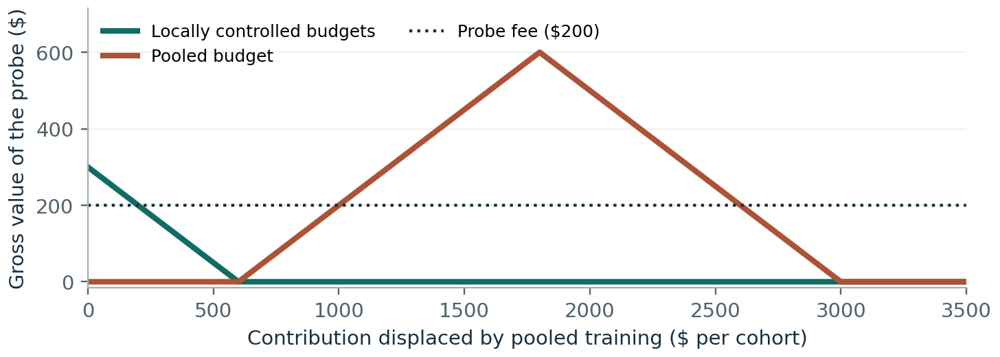
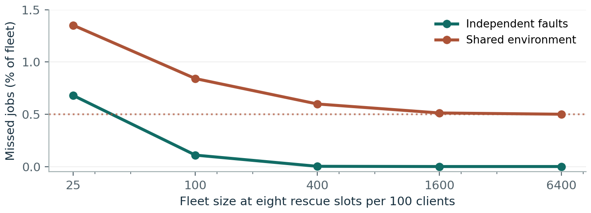
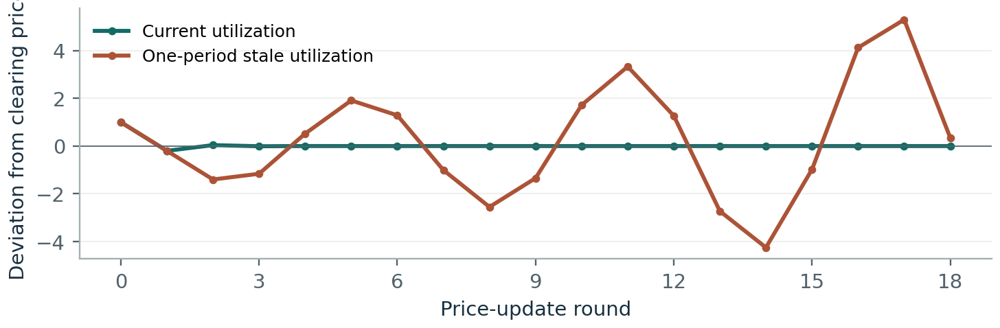

# The Autonomous Firm

[PDF edition](The_Autonomous_Firm.pdf) · [Replication and reading guide](README.md)

## The Autonomous Firm

*Theory of the firm  /  economics of machine production*

The opportunity cost of learning across digital agents, physical fleets and human operators

> An urgent job can change which data a firm should buy for a completely unrelated task. Sharing a scarce resource at a particular time is enough. No skill has to transfer between the jobs.

A firm deploying intelligence has two investment decisions. It chooses how to use today’s machines and labor to deliver accepted work. It can also spend those inputs to change what tomorrow’s machines can do, what evidence the firm will see, and who may act on it. These decisions meet in the same calendar of compute, field access, people, power and deadlines.

### What the theory explains

**Authority sets the price of evidence.** With switching costs, an operating signal is most valuable near a decision boundary. A competing job shifts that boundary. In an exact example, an unrelated deadline reverses which of two firms buys the same $200 diagnostic.

**Failure timing sets the price of accuracy.** With eight rescue slots and 100 clients, changing the coincidence of errors raises the value of a ninth slot from $0.63 to $2.75 at the same mean error rate. A putatively better policy can produce more missed orders.

**Contracts price a unit of time whose productivity changes.** At a fixed robot-hour fee, a faster robot can deliver more work, require fewer interventions per hour and lower the supplier’s total operating contribution. Demand expansion can also raise total human hours while their share falls.

### What is established

The propositions below are conditional derivations. Numerical results come from finite policy enumeration, probability calculations and a six-shift dynamic program with an independent accounting check. The commercial illustration uses public rate terms. Field causal effects, performance of autonomous LLM managers, and historical novelty remain open.

### Where the empirical foothold is

Ekya demonstrates that inference and retraining can compete on the same edge hardware [7]. Fleet-DAgger studies limited shared supervision in simulation and with four physical arms and two remote operators [9]. These are observable resource pools in which to measure displaced jobs, error covariance and subsequent learning. Neither study prices our proposed cross-market experiment.

Research starting points include the separate Recursive Firm Theory branch [1], the three supplied econophysics excerpts, and the decision, economic, systems and robotics literature [2–20]. Replication scripts accompany this paper.

## Who can change production?

*01  /  Scope and primitives*

Operational autonomy, recursive organization and ownership are separate dimensions of a firm.

**Operational autonomy** is the set of consequential decisions agents can commit under a mandate, budget and deadline. **Recursive capacity** is the ability to revise and retain the process that selects those decisions and experiments. **Integration** describes who controls assets, claims and the rights to observe, retain, train, validate and deploy. A human can set the commercial objective and still delegate all three decisions inside a given operating window. Formal and effective authority can diverge [2].

### One state, several networks

| Object | What the state records | Economic implication |
| --- | --- | --- |
| Production | Task, end market, embodiment, model version, accepted workload, deadlines and fallback | An update can meet a technical target while another stage still limits shipments. |
| Learning | Directed effect of source examples, simulation or hardware trials on target error at fixed compute | Transfer can be weak, asymmetric or harmful. Exposure is chosen by the operating policy [3, 8, 9]. |
| Shared inputs | Agent × resource × time incidence for accelerators, trained staff, cells, power and network capacity | Tasks compete even with zero data transfer or operational dependence. Different accelerator types may be incompatible. |
| Rights and time | Admissible messages, retained data, budgets, signoff latency, rollout permission, incidence of gains | A controller can see an error but lack a timely action. A contract can supply the same effective rights as ownership. |

V(s) = max over feasible a of { current contribution(s,a) + β E[V(s′) | s,a] }.

Current contribution is settled service revenue less actual labor, power, materials, compute costs, rework and contractual losses. State transitions include wear, retained evidence, model updates, beliefs, available cash, queues and changed decision rights. An internal transfer cancels in joint surplus. For a private firm use collectible cash, including external fees. Future data benefits enter continuation value once.

The inherited organization constrains the feasible action set. An operating action changes which states are visited. A learning action changes the policy. A recursive action can change how the firm selects and evaluates future learning actions. Test that last claim by transferring the revised procedure to an unfamiliar deployment with the initial execution policy held fixed.

Related branch result. In a synthetic optimum, adding a bypass fixture to a retrofit option raised one-hour firm value from 54.16 to 56.47 but lowered the value of the first operator-hour from 20.76 to 16.47 because the no-hour alternative improved more. A timely contingent contract matched common ownership [1].

## When congestion makes data more valuable

*02  /  Proposition 1*

A finite change in a remote workload can raise, erase or reverse the local demand for evidence.

Choose local or pooled training for one cohort. Before resource displacement, pooling has an expected advantage B that the probe reveals to be μ−δ or μ+δ with equal probability. Pooling occupies one scarce time slot. An unrelated job would earn x in that slot. Switching the inherited organization costs k either way. Relative to local, the action threshold is h=x+k for a local incumbent and h=x−k for a pooled incumbent.

Gross value of the report = ½ [δ − |μ − h|]₊.

Proof. Write [u]₊ = max(0,u). The informed chooser earns E[(B−h)₊] over the common fallback. Without the report it earns (μ−h)₊. Subtract and evaluate on the three intervals split by μ±δ. An incumbent-specific constant cancels. This is a decision value of information [4]. It peaks where the firm is indifferent before observing the report. Unequal signal probabilities give an asymmetric, piecewise-linear profile.

Figure 1. Exact enumeration. Pooled value before displacement is $9,000 with transfer and −$3,000 otherwise. Prior transfer probability is .30, posterior probabilities .20 and .40. Thus μ=$600, δ=$1,200 and k=$1,200.

At x=$0 the gross report values are $300 local and $0 pooled. At x=$1,500 they are $0 local and $450 pooled. At x≥$3,000 both are zero. A $200 probe therefore changes buyers. The distant job changes a real alternative use of capacity. A ledger entry charging both choices identically would cancel.

Rights can shift this boundary too. At x=$1,200 a pooled incumbent values the transient signal at $300. Grant a separate reusable training right worth a known $800 whenever pooled. Its optimal value rises, yet the report’s allocation value falls to zero because both signals now favor staying pooled. Late reports have no current allocation value when the choice has already become irreversible.

## The fleet pays for coincident errors

*03  /  Proposition 2*

A marginal slot has a time and a place. The timing of other agents’ errors determines what it buys.

Within one deadline window, let X clients need live rescue and c slots be available. A missed job costs b. When rescues have zero incremental cost, the next reserved slot is worth b·Pr(X>c). This follows by subtracting the two missed-job totals (X−c)₊ and (X−c−1)₊. The comparison is to the value of an alternative job that consumes precisely that slot.

| 100 clients; 8 rescue slots | Mean faults | Missed jobs / window | Value of slot 9 at b=$10 |
| --- | --- | --- | --- |
| Independent, each p=.05 | 5.00 | 0.1091 | $0.631 |
| Shared regime, p=.01 or .09 | 5.00 | 0.8408 | $2.753 |
| Improved mean, shared p=.005 or .075 | 4.00 | 0.4094 | $1.676 |

In each shared case the two regimes are equally likely, with independent clients conditional on the regime. The reserve decision precedes observing it. Each row is an exact binomial mixture. Against an unrelated $2 training job, the first fleet trains and the second reserves the slot for inference. The last fleet improves average accuracy relative to the first while missing more deadlines. With costly rescues or forgiving deadlines, the economic ranking can change.

Figure 2. Rescue capacity scales with fleet size. The independent limit is zero misses per client. In the shared regime the limiting missed fraction is 0.5%, even with identical individual mean risk.

Proof of the limit. If c/N tends to κ and errors are conditionally independent given a common error probability P, X/N tends to P conditional on the regime. Bounded convergence gives E[(X/N−c/N)₊] → E[(P−κ)₊]. Independent constant p gives (p−κ)₊. This is a kink in limiting overload under explicit assumptions. A finite rollout spike alone provides no evidence of a thermodynamic phase transition. Network congestion models supply a disciplined comparison [5, 6].

## What an error reduction is worth

*04  /  Valuing learning*

An economic training weight depends on who else will need the shared resource at the moment of failure.

Suppose each successful rescue now costs r, with b>r. Total realized loss is rX+(b−r)(X−c)₊. Preventing one specific fault saves r when there is spare capacity, or b when the other clients already fill the pool. Under conditionally independent faults and fixed peer policies, the local marginal loss per unit of error probability in observed regime z is

wᵢ(z) = r + (b−r) Pr(X₋ᵢ ≥ c | z).

With r=$0.50, b=$10, 99 peers and c=8, preventing a fault is worth $0.50 at p=.01 and $6.92 at p=.09. The same technical improvement has almost fourteen times the operating value in the stressed state. If an update also changes the joint dependence among errors, evaluate the new joint distribution. A static per-example loss weight omits that effect.

### Use the value to choose an experiment

For small updates at fixed workload, add exposure × marginal loss × expected causal reduction in error over market–state pairs. Subtract real acquisition, validation, rollout and displacement costs. Add the opportunity to change subsequent decisions only when that value has not already entered the forecast. The best choice reoptimizes across the complete firm where thresholds or shared operators make a linear approximation unreliable.

| Decision | Causal comparison for an autonomous allocator |
| --- | --- |
| Source or generate | Purchase a new demonstration, synthesize a matched case, or commission a physical probe. Hold the training and evaluation budget fixed. Account for the service displaced while collecting it. |
| Reweight or train | Hold corpus and rights fixed. Vary replay, mixture or post-training compute. Compare total accepted work on untouched targets and include negative transfer and extra inference cost. |
| Think at inference | Compare a longer inference path, verification, retrieval, another model or a human intervention at the current deadline. Charge the latency imposed elsewhere [7, 10, 18]. |
| Invest in capital | Compare software work with an alternative machine, tool, test cell or added accelerator. Include procurement lead time, depreciation, capacity released elsewhere and the change in future observations. |

Demonstrations, reward examples and corrections carry distinct information in real robot learning [19]. Data rights are action-specific. A sealed site can deliver current service. A contract might separately permit an aggregate diagnostic, local training or portable updates. A training scheduler may learn from simulation licensed elsewhere. Give the agent only permitted observations in each arm. The exposure that produces the richest dataset may be commercially infeasible or already solved at the source.

## How agents can trade time

*05  /  A cybernetic allocation mechanism*

The operative price is the loss imposed on other work when a particular agent takes a feasible bundle in a particular window.

For a fixed state, freeze agent i’s proposal. Compute the best attainable current-plus-continuation contribution of all competing uses with capacity C, then with C−aᵢ, the remaining time-indexed capacity after accepting the proposal. Their difference is its displacement cost. Score the proposal’s own incremental contribution, including its causal learning spillovers, against that cost. Optimize whole allocations when benefits overlap. Summing standalone agent bids can count a common improvement twice.

### How to implement it

Publish expiring capacity offers for accelerator class, operator skill, physical cell, power and completion time. Agents request bundles, attach a forecast of incremental service and learning, and identify the fallback if denied. A dispatcher clears feasible requests, reserves capacity, observes delayed outcomes and recalibrates forecasts. Internal debits inform decisions. External settlements enter firm cash. A price taker with a smooth objective and divisible inputs can use a dual price per unit; large indivisible jobs need explicit counterfactual scheduling [5, 11].

A boundary case has three slots A, B, C and three requests worth $1 apiece, one for each pair. Only one request can run. Suppose AB wins. Market clearing leaves unused C at price zero. Deterring both AC and BC requires each of A and B to cost at least $1. AB could then cost at least $2. No nonnegative linear slot prices clear this allocation. Bundle reservations or directly scheduled priorities can implement it.

### Stale prices have a measurable stability cost

λₜ₊₁ = λₜ + γ(qₜ − C),     qₜ = a − bλₜ,     b, γ > 0.

Near an interior clearing price the contemporaneous error multiplier is 1−γb. Its magnitude is below one for 0<γb<2. With a one-round reporting lag the characteristic polynomial is z²−z+γb and stability requires 0<γb<1. At γb=1.2 the current-signal controller converges; delayed roots have magnitude √1.2. Saturation, noisy arrivals and a trained strategic bidder require separate analysis.

Figure 3. Same initial deviations, demand slope and update gain. The delayed controller alternately over- and under-reserves. This linearized example measures feedback latency; it is separate from the deadline calculation.

## Robot-hours are capital services

*06  /  Production and labor*

An installed embodiment is a stock. Its productive operating hours are a flow. A validated model can change the output from both.

Robot service hours = installed units × available hours × utilization.

Write accepted output as Y=F(Sᵣ,Lₕ,π,D,E) with service flow Sᵣ, human hours Lₕ, policy π, data D and other complementary inputs E. MPKᵣ is the partial change in accepted output from an additional unit of installed robot capital over a specified period, holding the other primitive inputs fixed and accounting for induced feasible service. The marginal product of another machine-hour uses Sᵣ instead. A quality upgrade changes the function or the quality-adjusted stock. Report that change separately from an expansion in robot count [12].

Digital instances can be replicated rapidly subject to throughput, memory, energy, model access and latency. Physical replicas also need manufactured hardware, installation, maintenance and a qualified site. Robot and model hours have heterogeneous capabilities. Ten hours of one embodiment or model do not generally substitute for ten hours of another. Human shifts have learning, fatigue, scheduling and outside opportunities. Estimate these elasticities by workload and horizon. No universal statistical law for non-human labor follows from these distinctions.

### People can train a policy that reduces their future routine hours

Human hoursₜ = teaching hoursₜ + monitoring hoursₜ + αₜ × billed robot-hoursₜ.

Here α measures incremental intervention time per billed hour, exclusive of separately booked monitoring. A validated recovery can lower α. If billed hours grow by more than 1/(new α / old α), total routine intervention rises anyway. The physical marginal product of another supervisor can rise, fall, or become zero at a fully autonomous node. Record hours, accepted output, the labor income share and provider profit separately. Task displacement and demand expansion operate through different channels [13].

Kᵣ,t+1 = (1−d)Kᵣ,t + installations ordered at t+1−lead time.

The supply curve for robot-hours has a short-run capacity limit from installed stock and its first binding complement. An idle machine raises feasible service only if compute, supervision, demand and qualification also permit it. With positive manufacturing lead time, today’s order can respond to expected future shadow prices. Compare that investment with a policy upgrade increasing yield on the existing stock.

Empirical boundary. Lower takeover frequency can reflect easier work selection, better policy, less coverage or more silent failures. Preserve offers, declined jobs, human time, quality and customer acceptance at a fixed mix and track newly feasible work separately.

## Fixed hourly prices can penalize speed

*07  /  Proposition 3*

An hour is the unit sold. The operating policy changes how much accepted work that hour delivers.

Let r be the contracted robot-hour fee, q accepted units per billable hour, c(q) supplier operating cost per hour and ε the elasticity of demand for accepted service. With slack capacity, full pass-through of r/q as the service price, a nonbinding minimum and constant elasticity, billed hours H=D(r/q)/q are proportional to q raised to ε−1. Customer demand for output can rise while purchased machine-hours fall.

Contribution = (r − c)H.     On a g-fold speed gain:  Π₁/Π₀ = [(r−c₁)/(r−c₀)] g^(ε−1).

Take r=$14, c falling from $10 to $9, and q doubling from 10 to 20 accepted units/hour; initial activity is 2,000 billed hours. At ε=.5, output rises from 20,000 to 28,284 units, billed hours fall to 1,414, and operating contribution falls from $8,000 to $7,071. This is before the update’s development cost. With a fixed per-accepted-unit fee and fixed orders, the faster supplier can retain the reduction in unit cost. Cross-market rights, redeployment into another paying queue or contract renewal can reverse the hourly supplier’s incentive.

If α halves from .20 to .10 human hours per robot-hour in the same example, routine operator time falls from 400 to 141 hours at ε=.5. At ε=2.5 it rises to 566 hours while its share of unweighted operating hours falls from 16.7% to 9.1%. Those hours measure workload, not comparable efficiency units. When robot service is an intermediate input, a local pass-through τ and robot share s in final price replace ε by ετs for the demand channel, holding other costs fixed.

### A real contract benchmark

Tutor publicly lists $14–18 per robot-hour for palletizing and depalletizing, an 80-hour monthly minimum, a $10,000 implementation charge and an $8,000 refundable deposit. Case and each picking have per-pick pricing [15]. The Massachusetts basic minimum wage is $15/hour [16]. These are a seller’s posted terms and a wage benchmark, respectively. Customer-specific signed prices, actual interventions and margins are unknown.

At the $14 endpoint, spread implementation over three years and price the deposit’s carrying cost at an illustrative 6% annually. Uniform utilization of 1,000 actual hours/year gives $17.81 per run-hour; 4,000 gives $14.95. Both clear the minimum each month. The refundable principal is capital tied up. Compare customer cost per accepted unit at matched service levels, including local complements, to fully loaded human or specialist costs. For idle months use the monthly billing minimum; for binding capacity value the freed hour at its next-best use.

Capital risk remains over time. Provider profit must cover acquisition, financing, wear, downtime, qualification, teaching, renewal risk and replacement. A below-wage headline alone establishes neither a viable buyer case nor positive provider lifetime value.

## Who finances the next capability?

*Contracts  /  Human and machine investment*

An economically useful update can leave the worker, supplier and customer with different incentives to produce the evidence it needs.

The teaching hour produces an investment return alongside any service it delivers today. Private incentives can differ. Suppose extra voluntary teaching effort costs k and raises the probability of a validated improvement by Δp. Success costs the worker future employment rents J relative to their best alternative. A verified-success bonus b induces that effort if Δp(b−J)≥k under risk neutrality. Ordinary compensation for time is a separate cost. Reassignment, skill premiums, and gain sharing change J or b. The ratchet-effect literature gives an economic precedent for withholding improvements when rewards can subsequently be revised [14].

An introductory hourly price can also buy access to a useful operating environment. A subsidized pilot is rational only if collectible current contribution plus discounted incremental continuation value exceeds the best alternative, after setup, scarce capacity and rights costs. Upon renewal, a sealed site may still earn a service margin while offering little training value. Compare the same site under the same contract and workload with and without reuse rights.

### An intertemporal contract

Consider two contracts for the same service and service-level agreement. An hourly contract pays for productive runtime; a per-accepted-unit contract pays on delivery. A faster policy saves runtime. With fixed orders, the unit contract passes that operating saving to the vendor; the hourly contract passes much of it to the buyer. A lower-intervention policy at unchanged runtime saves the vendor’s support bill under either contract if support is included. These terms can select different training curricula even when both suppliers start with identical models.

A vendor that can redeploy a released robot-hour to another paying customer earns the margin of that alternative. Its private gain from speed then includes a capacity release. If the next customer has a scarce compatible gripper, validator or peak-time energy slot, that gain shrinks. A posted customer rate and the internal price of a robot-hour can move in opposite directions over the life of an unchanged contract.

> Look for differences in the kinds of improvements vendors fund. A vendor paid by accepted output should place relatively more value on throughput improvements where demand is fixed. An hourly vendor with scarce support should still pay for interventions avoided. Compare at the same rights, quality, utilization and renewal horizon.

The teacher incentive example assumes discretionary effort, contractible validation and risk neutrality. If the worker keeps the same job or has a better alternative, the rent loss J can be zero. Bargaining, worker mobility, fallback staffing and attribution of a team success require separate measurement.

## Six shifts, one training slot

*08  /  An integrated test economy*

An exact policy comparison connects the digital opportunity cost to robot service, paid human teaching, data permissions and learning.

A physical customer buys four productive robot-hours per shift for six shifts at $14/hour. Common nonhuman operating cost is $6/hour. The provider pays $25 per human hour, initially using .26 intervention hours per robot-hour. Once qualified, a learned policy needs .08 at identical accepted output. A reusable site can purchase a demonstration for $4 of additional labor, available next shift. One packet can be held. A training attempt consumes it and the sole accelerator slot and succeeds with probability .60. Failure permits recollection. Qualification begins the next shift.

Each shift also brings an unrelated digital job paying $2 or $24 net contribution, equally likely, observed before dispatch. It expires that shift. Running a physical robot uses its onboard controller; the shared accelerator is needed for post-training and the digital job. Acquisition can occur while serving the digital job. The finite horizon has no terminal resale or hypothetical data bonus. A sealed site can use live assistance but provides no reusable packet in this experiment.

| Six shifts / contribution ($) | Never train | Best advance calendar | Adaptive allocation |
| --- | --- | --- | --- |
| Reusable, one shared slot | 114.00 | 142.04 | 143.40 |
| Sealed, one shared slot | 114.00 | 114.00 | 114.00 |
| Reusable, two slots available | 114.00 | 160.24 | 160.24 |

### Why the economically preferred policy uses more human time

With one slot, the calendar acquires, trains, reacquires and retries while needed, then serves the remaining shifts. The best allowed adaptive rule anticipates more expensive digital work. It qualifies 2.70 expected physical shifts versus 2.88 for the calendar, makes 1.30 versus 1.40 expected training attempts and uses 4.520 versus 4.3904 total human hours. It saves $4.60 of displaced digital contribution and pays $3.24 more in human costs. Its advantage is $1.36. All arms deliver the same 24 physical robot-hours.

This is the digital-to-physical trade at the center of the theory. A human manager with the same contingent rule, timely observations and rights earns exactly the same return. The $1.36 prices timely conditional allocation over an optimized calendar. Adding the second available slot raises adaptive contribution by $16.84 before its acquisition cost and erases this particular value of discretionary timing.

Method. Backward dynamic programming with rational arithmetic enumerates feasible actions by state, signal and time. A separate forward recursion settles state probability mass and actual costs. Calendars are enumerated ex ante and skip infeasible actions after success. Pairwise tests, logs and code are included in the replication package.

## Can a firm retain a useful way to decide?

*Discovery  /  A held-out market*

A second exact economy holds the execution technology fixed and tests whether earlier paid observations improve the selection of a training investment.

Three binary features of each deployment are visible and independently fair. One unknown feature J predicts whether the pooled policy will qualify; each of the three is initially equally likely. On a source site, paying to observe the outcome rules out every feature that gave the wrong prediction. Each fresh target has its own independent feature values. Under the transfer hypothesis it shares J. The firm knows the candidate features and Bayesian sampling law, but never sees a hidden target label before committing.

Local operation earns zero incremental contribution. Pooled operation earns +9 if qualified and −3 otherwise, displacing an unrelated digital use worth 2 or 4 with equal probability, revealed before deployment. The institution may retain a discovery record, the set of features still consistent with observations. Its candidate actions and starting executor on a new site are identical across arms. The adaptive firm can buy up to five sequential source labels before one target, stopping as evidence accumulates. A fixed-budget comparator buys the best predetermined number.

| Shared predictive feature across markets | Source labels purchased | Expected target contribution after label cost |
| --- | --- | --- |
| Use only the local fallback | 0 | 0.000 |
| Use target features and prior; no source labels | 0 | 1.500 |
| Best fixed program; $0.15 per label | 3 | 2.253 |
| Adaptive program; $0.15 per label | 2.543 on average | 2.541 |
| Oracle already knows J | 0 | 3.000 |

Higher source prices matter. At $0.30 per label the best fixed count falls to two (net 1.838); adaptive stopping earns 2.160. Break the link by drawing a fresh independent J at the target and the frozen $0.15 adaptive rule earns only 0.634 after collection costs. Reverting to the correct target prior earns 1.500. Retaining a once-successful discovery rule can destroy value under an unrecognized shift.

This separates the return to a portable diagnostic from the return to improving the executor. It also puts a limit on the autonomous-firm claim: an equally informed Bayesian rule earns the full adaptive value here. The diagnostic family and update rule are supplied. A stronger experiment lets an agent propose features or a new experiment and tests the retained invention on withheld task families under matched budgets.

Replication uses exact enumeration of source-site labels and an independent forward evaluation of the stopping policy. The opportunity units on this page belong to this economy alone.

## Which collective effects would count?

*09  /  Statistical mechanics*

The unit of analysis is a population of machine policies acting with shared constraints and possibly correlated errors.

Use a distribution of local states indexed by policy version, embodiment, demand class, installed capacity, battery or thermal state, current queue and remaining slack before deadline. A microstate records which agent holds a slot. An aggregate state tracks the occupancy distribution, accepted throughput, tail of delay, missed fraction and frequency of joint failures. An exogenous common shock and a change in the agents’ policy can produce similar aggregate movements. Estimate them separately.

### Three clocks that matter

| Clock | Observable quantities | Testable effect |
| --- | --- | --- |
| Serving and dispatch | Request arrival, completion deadline, live GPU queue, reserve human availability | A brief loss of capacity can erase a high-value job even if daily average utilization is low. |
| Learning and rollout | Time to assemble a lawful corpus, train, validate, publish and propagate a policy | A technically successful update arriving after the contract or seasonal peak loses much of its value. |
| Capital and replenishment | Robot lead time, spare parts, energy and cooling headroom, installation and worker skill supply | A persistent compute shortage may justify capex; a single transient shortage may favor scheduling or rented capacity. |

Connect physical constraints to the decision state. Within each interval enforce power and energy limits, access to compute of the right memory class, robot availability and validator capacity. A thermal state may follow T′=aT+bP−cooling, calibrated to actual equipment. A control that violates its rated envelope is infeasible. Facility-scale electricity and cooling loads are measured in the Berkeley Lab energy report [17]. The sources do not establish a single thermodynamic growth bound for a heterogeneous economy.

For a phase-transition claim, specify a sequence of systems and a scaling rule. Increase fleet size at fixed per-agent capacity and matched demand; vary load, synchronization or feedback delay. Estimate the limiting fraction of missed deadlines, persistence after a shock and sensitivity to small changes. Compare staggered rollout to synchronized rollout and a common-cause model to independent faults. A finite discontinuity at a qualification threshold, a deadline, or a price kink has its own simple economic explanation. A universality claim would require further evidence over architectures and sizes [6].

This uses the supplied excerpts as prompts for measurement. Machine agents can share weights, data, environmental shocks and incentives. Humans also exhibit correlated behavior. No assumption of purely RL-controlled firms, universally faster physical operations, or a distinctive universal tail exponent enters the results.

## An experiment that could defeat the theory

*10  /  Identification*

Test discovery, allocation and organizational change separately. Each has a competent comparator.

**State and action interface.** Use a controlled, partially observed environment with digital service, two physical task families, lawful field and simulation sources, heterogeneous hardware and an external demand process. Track hidden transfer regime and common operating shocks for scoring only. Expose orders, deadlines, approved traces, quotes and realized settlements. Distinct actions include buying evidence, changing corpus weights, assigning inference effort, reserving compute, validating a policy, renting capacity and revising budget authority. Charge every action in real time and resources.

**Economic RL.** Two-level economic RL supplies a design precedent [20]. The upper policy proposes investigations and feasible allocations; lower policies execute tasks and update from admitted data. Use net accepted-service contribution with discounting, customer constraints and explicit penalties for rejected or late work. A diagnostic reward is credited via subsequent operating decisions. Counterfactual estimates can guide exploration; final evaluation uses settled outcomes. Start with an exact small-state oracle and optimal contingent rules, then compare learned allocators and a human manager under the same information, compute, rights, delays and review budgets. A full-information oracle is a separate bound.

| Intervention | Observable implication and decisive comparison |
| --- | --- |
| Unrelated deadline × capacity × inherited authority | At fixed physical cases, move a digital order into or out of the shared slot. Probe demand should reverse in the specified intermediate region. Repeat on dedicated capacity; the displacement channel then vanishes. |
| Policy sharing × rescue capacity | Randomize staggered vs joint rollout in compatible blocks. At fixed mean error, measure the joint tail, accepted orders and emergency slot value; isolate common environment and common model version. |
| Rights × learning × held-out market | Vary collection at fixed compute, then replay at fixed corpus. Keep source and target rights explicit. On fresh sites replace the proposer and freeze the initial executor. Compare revised discovery procedure with a purchased or preauthorized procedure. |
| Contract × demand response | At matched quality and task mix, compare per-hour and per-unit pricing around a throughput change. Measure billable time, total hours, accepted units and both parties’ surplus. Track minimums, lost orders, repricing and newly viable sites. |

Randomize by independent compute and operator pools or explicitly estimate interference across arms. Reserve unseen tasks, suppliers, embodiments and demand regimes; predefine allowed search and net contribution per budget. Record refused jobs and silent failures. If gains vanish against a cheap contingent schedule, attribute them to scheduling. Evidence for recursion requires an improved discovery method retained and successfully used beyond its originating case.

## Research sources and scope

*11  /  Prior work and evidence*

Titles link to primary work. Source results motivate components; all dollar-valued counterfactuals in this paper are illustrative unless identified as public offers.

**[1]** [RoboEcon, The buying power of a teleoperation hour](https://github.com/amarmurray/robotics-economics/blob/127130c5ac2b6c5eb638f3d62cc1d2e5ede1d897/research/recursive_firm/stack/README.md). Related research thread, immutable branch snapshot 127130c. Exact rights and embodiment comparisons and synthetic nested learning benchmarks. The separate allocator beat the strongest tested fixed rule in four of twelve model–seed comparisons. It supplies a comparator for this paper.

**[2]** [Aghion & Tirole (1997), Formal and Real Authority in Organizations](https://doi.org/10.1086/262063). Who holds decision rights and information affects effective control. This paper adds a deadline and a competing use of machine capacity.

**[3]** [Farboodi, Koh & Xia (2026), Data-Driven Automation](https://www.nber.org/papers/w35320). Working paper on endogenous production of heterogeneous task data and productivity spillovers. The shared-resource channel developed here also operates with zero cross-task learning.

**[4]** [Howard (1966), Information Value Theory](https://doi.org/10.1109/TSSC.1966.300074). Decision-contingent valuation of information. Proposition 1 specializes that logic to two inherited organizations and an external compute debit.

**[5]** [Kelly, Maulloo & Tan (1998), Rate Control for Communication Networks](https://doi.org/10.1057/palgrave.jors.2600523). Network resource prices and stability under an explicit optimization model. Our finite-window displaced job and delayed-price example use different objectives.

**[6]** [De Martino et al. (2009), Congestion Phenomena on Complex Networks](https://doi.org/10.1103/PhysRevE.79.015101). A specified traffic model yields free-flow and congested phases. Our common-regime calculation concerns overload and tests for collective behavior in fleets.

**[7]** [Bhardwaj et al. (2022), Ekya](https://www.usenix.org/conference/nsdi22/presentation/bhardwaj). A working video-analytics system schedules inference and retraining on shared edge GPUs. Its measured accuracy/resource tradeoffs motivate feasibility; they do not measure a deployer’s dollar return.

**[8]** [Hejna et al., ReMix (CoRL 2024, PMLR 2025)](https://proceedings.mlr.press/v270/hejna25a.html). Robot imitation-learning mixtures were tested against uniform and human-selected weights. Commercial loss-weighting, end-market demand and budgets are additional economic choices.

**[9]** [Hoque et al. (2023), Fleet-DAgger](https://proceedings.mlr.press/v205/hoque23a.html). Shared human supervision across multiple robots makes the intervention queue a concrete institutional and technical object.

**[10]** [Sardana et al. (2024), Beyond Chinchilla-Optimal](https://proceedings.mlr.press/v235/sardana24a.html). Joint modeling of language-model training and expected inference demand changes the cost-optimal configuration. Robot error elasticities and deployment-specific learning curves require their own estimates.

### Additional methodological precedents

**[18]** [Snell et al. (2025), Scaling LLM Test-Time Compute Optimally](https://proceedings.iclr.cc/paper_files/paper/2025/hash/1b623663fd9b874366f3ce019fdfdd44-Abstract-Conference.html). On tested reasoning problems, adaptive inference strategies depend on difficulty. Use deployment-specific loss and latency when estimating the return to another inference step.

**[19]** [Luo et al. (2025), Precise and dexterous robotic manipulation via human-in-the-loop reinforcement learning](https://pubmed.ncbi.nlm.nih.gov/40834062/). Physical experiments establish that demonstrations and corrective human feedback can support rapid learning on selected tasks. Their training times do not determine a market return on operator labor.

**[20]** [Zheng et al. (2022), The AI Economist](https://doi.org/10.1126/sciadv.abk2607). Two-level economic RL with co-adapting policies motivates an institution-aware comparator. The toy tests conducted here use exact optimization, not a trained LLM or an observed autonomous business.

## What can be reproduced

*12  /  Sources and replication*

Numerical results are checked at the level of individual allocations, probabilities, costs and outcomes.

**[11]** [Bikhchandani & Mamer (1997), Competitive Equilibrium in an Exchange Economy with Indivisibilities](https://www.sciencedirect.com/science/article/pii/S0022053196922693). Equilibrium with indivisible goods. The three-slot example is an elementary counterexample to relying on scalar prices for every reservation problem.

**[12]** [US Bureau of Labor Statistics, Productivity Measures: Concepts](https://www.bls.gov/opub/hom/msp/concepts.htm). Capital input is measured as a flow of productive services. Installed machines, hours of use and improvements in quality call for separate measurements.

**[13]** [Acemoglu & Restrepo (2019), Automation and New Tasks](https://doi.org/10.1257/jep.33.2.3). Task allocation, displacement, productivity and reinstatement effects give an economic baseline for the changing role of human labor.

**[14]** [Carmichael & MacLeod (2000), Worker Cooperation and the Ratchet Effect](https://doi.org/10.1086/209948). Incentives to reveal productivity improvements can depend on subsequent changes in compensation. The teaching-bonus example is a proposed application.

**[15]** [Tutor Intelligence, Usage-based robot pricing](https://tutorintelligence.com/pricing). Public offer checked 20 November 2026 US Eastern. Hourly and per-pick terms apply to specified workflows. Neither field performance nor realized customer profitability is disclosed by this quote.

**[16]** [US Department of Labor, State Minimum Wage Laws](https://www.dol.gov/agencies/whd/minimum-wage/state). Massachusetts basic minimum rate used solely as a comparison for the posted robot-hour rate.

**[17]** [Shehabi et al. (2024), United States Data Center Energy Usage Report](https://eta.lbl.gov/publications/2024-lbnl-data-center-energy-usage-report). Evidence for measurable energy and cooling requirements underlying digital and physical operations.

### Replication package

Run **python run_all.py** in the companion directory with Python 3.10 or newer. The six calculation modules use the standard library. The script produces a consolidated text report of the tent identity checks, binomial mixtures, feedback stability, indivisible reservations, fixed-price economics exact dispatch comparisons and held-out discovery tests. The saved reference output permits inspection without execution.

The held-out example tests a different choice from the posted-rate comparison. The six-shift example fixes an operating contract and omits customer adoption; the hourly-demand calculation allows volume to expand and assumes slack capacity. The deadline model fixes a common stochastic environment; the delayed-price model studies feedback separately. Combining their parameter values into a single forecast would require a shared time base, documented rights, workload traces and measured cost curves.

> A decisive observation would be a firm repeatedly paying to learn in a technically unrelated business because the competing use of a timed resource moved a decision across its threshold. Its absence under matched rights, workloads and deadlines would narrow the theory.
