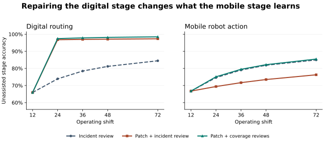

# How a fleet changes the rate at which it learns

Recursive Firm Theory · Learning in production

A firm that handles exceptions learns from a sample it helps to create. A better digital routing agent can prevent an exception from reaching a reviewer. That decision can improve today's complete order while depriving an entirely different robot of tomorrow's training example. A firm can respond by inspecting successful work, changing what goes into replay, or ending a harmful transfer between models. These decisions consume operator time and compute. The relevant question is when the improved downstream work pays for them.

This study contains a conditional scaling result, a reanalysis of two real robot tasks, a mixed digital/physical learning experiment and a solved problem about how often to revise an internal allocation objective. [Scaling code and published numerical inputs](scaling.py) · [Mixed-fleet environment](fleet.py) · [Numerical scaling results](scaling_results.json) · [Matched fleet comparisons](fleet_results.json)

## Production changes the training distribution

Index a node by task, site and embodiment. One model can serve several nodes, and a complete order can require several nodes to succeed. Three evolving objects distinguish levels of recursion.

| State | What operating experience can change | Observable comparison |
| --- | --- | --- |
| Task policies and capabilities | A new release changes execution on a fixed panel of opportunities | Frozen pre/post version, same contexts and acceptance metric |
| Corpus, replay mixture and transfer | Better execution changes which events are exposed, which are reviewed, and whether their updates improve other nodes | Source-to-target update against a matched alternative, plus independent records outside the incident queue |
| Rule governing the next investment | Validation changes who receives shared updates, how many hours are spent acquiring evidence, and when the internal objective is reviewed | Frozen rule against an evidence-responsive rule with the same opportunities, charging its costs |

At release time let $p_j$ be target capability and let $T_{ji}(s)$ be the *signed* change in target $j$ after a candidate update from source $i$, relative to the best specified alternative at the same snapshot $s$. A no-update comparator prices the gross change. Replay on the same compute budget prices the decision to train on that source. A transfer matrix measured at one release need not survive a new policy, embodiment or task mix.

If target probabilities are conditionally independent given order context $x$, the expected unassisted contribution from a pipeline with stages $P_r$ is $Y=\sum_r m_r D_r\,\mathbb E_x[\prod_{j\in P_r}p_j(x)]$. Here $D_r$ is work offered and $m_r$ is the margin on a completed unit. A stage's marginal operating value includes the success of every complementary stage on that same case. With dependent stage errors, estimate joint completion directly. For small changes, the value of an admitted example involves the directed transfer gains weighted by these marginal contributions. The expected value of visiting a source also multiplies by the probability of obtaining an informative, admissible record, subtracts operator and training costs, and includes the value of changing the future evidence supply. Multiple neurons or agents changing together call for a paired test of the joint update.

## Proposition 1. A scaling law per example becomes a different law per deployment opportunity

Suppose a donor's reducible error is $e_i(n)=a_i(n+b)^{-\alpha_i}$ after $n$ effective independent learning records. Production supplies $v$ opportunities per time unit. An opportunity produces such a record at rate $q e_i(n)^\gamma$, with $q>0$, $b>0$ and $\gamma\ge0$. Here $q$ includes admissibility and conversion to a useful update. Assume stable demand, transfer, positive learning elasticity and slack processing capacity. Integrating $\dot n=vq a_i^\gamma(n+b)^{-\alpha_i\gamma}$ gives

$$
(n+b)^{1+\alpha_i\gamma}=b^{1+\alpha_i\gamma}+(1+\alpha_i\gamma)vq a_i^\gamma t,
\qquad e_i(t)\asymp t^{-\alpha_i/(1+\alpha_i\gamma)}.
$$

A recipient $j$ with $e_j(z)=a_j(z+b_j)^{-\alpha_j}$ that receives $z=\tau n$, $\tau>0$, from this donor and has no other evidence stream has deployment-time exponent $\alpha_j/(1+\alpha_i\gamma)$. **Its rate of improvement depends on how quickly its donor stops needing help.** For example, an inverse-square-root curve against usable records becomes an inverse-cube-root curve against deployments when only mistakes yield evidence. Adding a continuing positive rate of *informative* independent audits restores linear record growth and the example-time exponent eventually. The crossover can occur beyond the useful life of the deployment.

This result converts a conditional learning curve and an observation rule into a time path. It does not estimate an exponent from industrial data. A mistake can be much more informative than a random case. Repeated irreducible errors can generate many tickets and zero transferable evidence. A new task can open a second donor stream. Each changes one of the premises. In 160 independent event-time simulations per setting, an imposed $\alpha=0.5$ produced mean late-window slopes of 0.334 when $\gamma=1$ and 0.246 when $\gamma=2$, against theoretical values of 0.333 and 0.250. Those checks validate the timing calculation. The separately trained policies below have no imposed power-law curve.

**Fleet size and compute can bind at different times.** With $F$ independent deployments and capacity for $K$ distinct updates per shift, the exact discrete intake is $\mathbb E[\min(K,A)]$, where $A$ is the number of distinct informative arrivals. Under independent Bernoulli arrivals $A\sim\mathrm{Binomial}(F,q e^\gamma)$. In the fluid approximation the switch between a capacity-limited and an evidence-limited phase occurs near $Fq e^\gamma=K$. A snapshot can therefore make the same fleet look compute-limited early and data-limited later.

In a separate 128-shift test across 256 matched worlds, increasing independent sources from 16 to 64 with one update slot brought terminal error from 5.21% to 4.45%. Keeping 64 sources and increasing slots from one to four brought it to 2.83%. Increasing from 16 to 64 slots at those same 64 sites moved it only from 2.72% to 2.71%. With perfectly duplicated source records, one site and 64 sites both ended at 10.83%. This last treatment is a boundary case for correlated experience, useful for identifying false scale from replica count. These percentages belong to the stipulated learning curve.

**Which branch of the fleet governs the exponent?** If a target can substitute independent evidence from finitely many donors, $z_j(t)=\sum_i \tau_{ji}n_i(t)$ with positive fixed transfer weights and $n_i(t)\asymp t^{\nu_i}$, then $z_j(t)\asymp t^{\max_i\nu_i}$ over the active incoming links. If mastering the task requires a distinct validated skill from each source and useful complete sets are limited by $z_j(t)=\min_i\{\tau_{ji}n_i(t)\}$, the slowest exponent governs. Both follow by bounding the finite sum or minimum between constant multiples of the dominant power. A tiny but persistent independent audit stream can eventually govern a substitutable pool. A missing mechanical skill can still limit complete service. Signed interference, redundant records and strategy changes require estimating the applicable aggregation before using either result.

## When learning creates more opportunities to learn

The incident channel above closes as a task gets easier. Qualification opens another channel. Suppose work on an established lane can contribute at most $M$ distinct usable records to a harder lane, whose qualification threshold is $n^*$. If $n_0+M<n^*$ and each new lane produces evidence only after qualification, the harder lane remains unreachable under passive operations however many jobs the incumbent fleet completes. A validated practice or shadow deployment can bridge the shortfall. Once qualified, the second lane can produce additional evidence simply by doing its own work. Its continuation value can make an otherwise uneconomic practice run worth funding.

A finite-horizon dynamic program compares funding practice to waiting. The old lane earns 2 per shift at 95% accuracy and can convey only two distinct target records. The new task starts at 50% skill, gains five points per distinct validated record up to 95%, and qualifies after four records. A qualified order yields expected contribution $6p-3$ and one new record up to the cap. Practice costs 3 per record attempt, the operating opportunity set and horizon are public, and the code settles the selected policy independently. Over four shifts the optimum funds zero trials. Over 16 it funds two, qualifies in shift three, and earns 59.30 against 32.00 for passive operation. With 50% trial yield it still earns 47.93. With four distinct transferable records already available from incumbent work, passive operation qualifies in shift five. These are stipulated qualification and learning curves.

When the new lane opens, mean completion across attempted jobs drops from 95% to 82.5%, even as the incumbent retains its skill, the harder task reaches 70% and incremental contribution is positive. This offers a second reason to evaluate a recursive firm both on a fixed task panel and on the expanding set of work it undertakes.

## What real robot evaluations say about the unit of scale

We transcribed the 42 aggregate scores in Tables 6 and 10 of the first public version of Lin et al. The authors train policies with one through 32 environment–object pairs and several fractions of the data within each pair. We compare a narrow and a broad training set at matched *nominal* collection volume. Exact valid trajectory counts vary after filtering. The outcome is a normalized graded task score on unseen contexts. It differs from a binary success rate. [Source tables](https://arxiv.org/html/2410.18647v1) · [Peer-reviewed paper](https://proceedings.iclr.cc/paper_files/paper/2025/hash/88b7b2c896506daabc8d3fd587055167-Abstract-Conference.html)

| Training composition at the same nominal volume | Pour water | Arrange a mouse |
| --- | ---: | ---: |
| 8 environment–object pairs, all available traces per pair | 62.50% | 55.83% |
| 32 pairs, one quarter of the available traces per pair | 84.17% | 86.67% |
| Difference in normalized score | +21.67 points | +30.83 points |

We also retrospectively withheld an entire breadth level. We fitted a power curve for remaining score gap using log nominal volume, then allowed a second coefficient on log number of pairs. A flexible count-only lookup is a third benchmark. In each test, fitting used only smaller breadths. At 16 pairs, adding breadth cut mean absolute prediction error from 12.77 to 5.56 points for pouring and from 27.97 to 12.84 for arranging. At 32 pairs it improved arranging from 18.39 to 5.68 points and worsened pouring from 8.60 to 9.59. One equation did not extrapolate best in every case. The available aggregates do not support trial-level uncertainty or identify the incident-arrival exponent. The experimental data describe learned robot skills and do not record firm cash flows.

For digital models, Xie et al. tune the pretraining mixture with a smaller language model and evaluate a larger one. Ye et al. test predictions across held-out data mixtures and study retention of old capabilities in continual training. Open X-Embodiment provides direct examples of cross-robot transfer. Farboodi, Koh and Xia place heterogeneous task data, production and spillovers in an economic model. Our additional mechanism is that a deployment policy changes the subsequent arrival rate and composition of *usable* examples at other nodes. [DoReMi](https://proceedings.neurips.cc/paper_files/paper/2023/hash/dcba6be91359358c2355cd920da3fcbd-Abstract-Conference.html) · [Data Mixing Laws](https://arxiv.org/html/2403.16952v2) · [Open X-Embodiment](https://arxiv.org/abs/2310.08864) · [Data-Driven Automation](https://www.nber.org/papers/w35320)

## The digital fix and the physical learning cost

A digital agent first releases each of 18 orders per shift. Six orders each go to a digital desk agent, a fixed arm and a mobile robot. Each recipient must interpret a shared disposition, such as which side a parcel or record belongs on, using its own action coordinates. Thirty-two case families occur at different frequencies by lane. Native policies and the upstream release model learn probabilistic binary actions from noisy, labeled examples. The model includes licensed shared evidence, local labels, signed transfer under embodiment mismatch, paid human review, scarce compute, and separate accounting for stage capability and orders completed. The digital tasks represent LLM-agent functions. The execution is a symbolic Bayesian learning environment.

A human review can clear the digital stage and provide a labeled routing decision and transferable disposition from one reconstruction. This is the substantive joint-production assumption. A digital patch independently clears 90% of the gate mistakes that would otherwise remain. Its action supplies no disposition label. Native examples arrive independently for each downstream lane every fourth shift. All comparisons hold matched orders, latent states, label noise and policy randomness fixed across 96 independent worlds. The first 12 shifts use incident sampling with the patch off. Within a given compute, native-label and sharing regime, patch comparisons begin with identical policies. The following 60 shifts generate the reported cash and evidence. We score final unaided capability by integrating over the full reference distribution. No privileged target labels enter the collector.

| Policy in the aligned reference fleet | Routing accuracy | Fixed-arm capability | Mobile capability | Mean human case reviews during 60 shifts | Operating contribution during 60 shifts |
| --- | ---: | ---: | ---: | ---: | ---: |
| Review routing incidents | 84.47% | 84.69% | 84.96% | 156.81 | 5,223.48 |
| Introduce patch, review remaining incidents | 97.35% | 75.99% | 76.27% | 32.00 | 5,307.53 |
| Introduce patch, fill all slots with random reviews | 98.43% | 84.69% | 84.81% | 180.00 | 5,442.60 |
| Introduce patch, favor underrepresented families | 98.50% | 85.42% | 85.48% | 180.00 | 5,568.90 |

The patch increases operating contribution by 84.05 before its acquisition cost (paired 95% interval 60.88 to 107.21). Yet the mobile skill loses **8.69 percentage points** (8.32 to 9.06). Both can occur because more orders clear the digital stage even as the robot falls behind its counterfactual learning path. With a steady budget for coverage reviews, the same patch changes mobile capability by −0.05 points (−0.35 to +0.24). When the upstream record cannot train any downstream policy, the estimated patch effect on downstream skill is exactly zero by construction. Quadrupling the independent native labeling frequency reduces the mobile loss to 5.22 points. These comparisons isolate the evidence channel.

**What paid for the improvement?** Conditional on the patch, coverage review beats incident-only review by 261.36 contribution units at the reference prices. In a tighter experiment we give coverage review exactly the incidental policy's realized number of slots *in every shift*. This retrospective comparison improves mobile capability by 0.71 points but costs 51.61 units of near-term contribution as some live rescues go unperformed. If compute admits only one of three reviewed records per shift, coverage still improves mobile capability by 4.81 points. Its mean operating advantage becomes −8.67 with a paired interval from −27.87 to +10.52. Collecting more events and having the capacity to learn from them are separate investments. With a midrun shift to a different case mix, coverage gains 11.42 mobile points over incident-only review.

**When to stop transferring.** A separate treatment reverses the mobile action convention halfway through operating history. A shared representation that was appropriate now recommends the wrong action there. On each paid independent native example we score the local and pooled policies *before* updating either with its label. A short moving average of their relative Brier loss decides which policy the lane uses next. In the shifted worlds always pooling ends with 19.13% mobile accuracy. Validation-controlled pooling ends at 50.23%, the same terminal mean as using only local data on mobile, while the digital desk and fixed arm can keep using the source. In stable worlds the same validation rule costs 1.05 mobile points relative to always pooling. It learns when to disconnect a link. Learning the correct new action adapter would be a further capability. [Per-lane trajectories, costs, case counts and uncertainty](fleet_results.json)

## Which evidence is worth generating next?

We also let a higher-level controller bid for its own next records. For a probability-matching binary policy with a beta posterior of $n$ pseudo-observations and posterior mean $q$, its subjective expected one-step accuracy gain from another label is $2q(1-q)/(n+1)^2$. This follows from the variance of its next posterior mean. The model-based bidder multiplies those local gains by observed case frequencies, lane margins, the probability that complementary stages succeed, remaining planning horizon and which transfer links its validation supports. It adds the benefit of rescuing a current order, subtracts prices and can leave a slot unused. The approximation treats the fixed true labels and noisy reviews as exchangeable Bernoulli data, which can misprice later evidence. General coordination overhead is held at zero across methods.

The fixed comparator reserves zero, one, two or three reviews per shift and first rescues available incidents. A separate calibration panel of 24 worlds selects the reserve that maximizes operating contribution. We also select the bidder's horizon from 3, 12, 36 or 60 shifts on those same calibration worlds, then freeze both decisions for the 96 evaluation worlds. The unchanged 12-shift rule is reported alongside the selected horizon, and the highest-valued control can always decline an unprofitable review. Both sides receive identical native validation opportunities. The numeric comparison below uses incremental paid contribution over the evaluation window, with no terminal resale value for the learned model.

| Held-out economy | Best calibrated fixed reserve | Bidder with a 12-shift horizon, cash difference | Calibrated bidder, cash difference and paired 95% interval |
| --- | --- | ---: | ---: |
| Stable, ordinary review cost | Fill all three slots | −47.74 | +152.97 [134.72, 171.22] |
| Stable, review costs 5 instead of 1.50 | Rescue incidents | −56.88 | +175.44 [157.39, 193.49] |
| Mobile convention reverses | At least two slots, incident priority | +62.12 | +159.98 [141.01, 178.95] |

Calibration selected the 60-shift upper end of the tested horizons in all three settings. The bidder still truncates the horizon at the remaining shifts. The tuned model beats these four fixed rules on operating cash in the three environments tested, while ending with lower autonomous margin in the ordinary stable case. The 12-shift rule loses to the fixed reserve in two settings. These distinctions matter for an organization deciding whether research creates near-term operating income, post-window capabilities, or both. No result establishes a globally optimal policy or planning horizon. The horizon controls how far forward the bidder values evidence. The next proposition concerns the separate interval between revisions.

## Proposition 2. The right timescale for revising the objective can be finite or infinite

Consider an allocation mandate targeting one of two bottlenecks, digital or physical. The productive bottleneck switches symmetrically each shift with probability $0<p<1/2$. Targeting the right one earns an incremental $g>0$. At any time the firm can buy an accurate audit of which bottleneck bound $d$ shifts ago for a fee $c$. Untagged operation supplies no separate diagnostic signal. A standing mandate picks the last reported bottleneck until the next revision. This isolates the slow rule for selecting an objective from the faster task learning studied above.

With $\rho=1-2p$, a report of age $d+k$ matches today's state with probability $(1+\rho^{d+k})/2$. The long-run net reward per shift under review every $h$ shifts is

$$
R(h)=g/2+\frac{g\rho^d(1-\rho^h)}{2h(1-\rho)}-\frac{c}{h},\qquad R(\infty)=g/2.
$$

The expected reward profile after an audit is identical for either reported state. With no additional interim signal, randomizing the next review time or conditioning it on that state's name cannot exceed the best reward-per-time ratio across intervals. This gives an optimum over admissible historical review rules. Some finite review strictly improves on a standing choice **if and only if** $c<g\rho^d/(4p)$. In the slow-drift, many-shifts-between-reviews limit $h^*\approx\sqrt{2c/(gp\rho^d)}$. A finite-horizon Bellman solution that may review or wait at every date independently checks the long-run result.

At $g=1$, $c=0.60$ and a three-shift audit lag, the optimal interval is 12 shifts at a 1% switch probability, seven shifts at 5% and 10%, and **no paid revision through this signal** at 20%. At 20% and zero lag the optimum is every three shifts. This is a precise limit on the proposed adiabatic allocation rule. A rapidly moving fleet can favor faster revision when fresh validation is available and favor a standing mandate when each paid report arrives stale. Faster free telemetry, asymmetric costs, costly implementation or a continuously informative reward stream would change the problem.

## Identification and the next experiment

Measure an upgrade at three places. Keep a versioned panel of cases available after routine incidents vanish. Measure the trained destination skill unaided on that panel, including rare families and the same target embodiment. Track realized orders, origin-to-destination permissions, interventions, useful updates and their true compute and expert costs. Fork each candidate release against a same-budget replay model, using untouched destination cases with timestamps and task families grouped. Randomize a small audit share on successful work across matched deployment clusters, or randomize the timing of introduction where operationally feasible. Shared weights can contaminate a site-level control, so maintain independent model branches or randomize whole sharing clusters. Record offered opportunities and refusals as denominators and continue until deployment and model-qualification delays have elapsed.

The central empirical prediction is an interaction. An upstream improvement that suppresses shared reviews should slow downstream learning most when those reviews previously supplied unique transferable evidence, native labels are scarce and compute can use the missing rows. Independent coverage should attenuate the effect. A matched upstream upgrade that preserves the evidence path, or equal downstream learning with and without affordable coverage over a sufficiently powered window, weakens this explanation. Measuring a lower isolated task score alongside more accepted orders is possible and worth reporting.

The next test should let the fleet decide whether to reopen, repair or retire several transfer links when both donor and recipient policies drift. Charge the validation capacity consumed by discovering each link. Compare against fixed sharing, separate task heads, a standing audit sample and a model of interference. Estimate effects on future records as well as present accuracy. This asks whether a firm can build a better process for discovering what transfers after its last success changes the data it will see.

### Reproduction

Run in this directory with Python 3.12 and NumPy. Matplotlib is used only for the figure. The source tables and random seeds are recorded in the code. World-level paired intervals are normal-approximation Monte Carlo intervals conditional on this environment. They do not represent field, specification or model-class uncertainty.

~~~sh
python run_study.py
python -m unittest -v test_dynamics
python plot_learning.py
~~~
