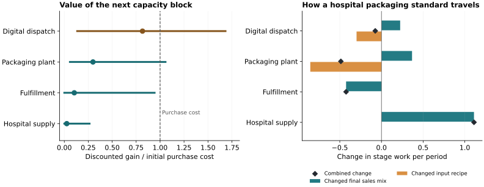

# Where does a better robot raise the return to the next one?

Recursive Firm Theory · November 25, 2026

A hospital changes the packaging it will accept. Its supply robots can serve more orders. A packaging plant upstream can consequently face **less work and a lower return to its next robot**. A fulfillment operator that serves the hospital can lose retail orders while taking on hospital work. The plant's engineers can still produce evidence worth buying for the hospital fleet. Quantities, investment returns and evidence travel over different links.

This study develops a multivariate marginal product of robotic capital, measures how a change at one firm revalues capacity at another, and tests where to buy the next piece of evidence. The main example uses digital dispatch, a packaging arm, a fulfillment robot and a hospital supply robot. It compares 96 independent synthetic economies, two supply-chain architectures and a separately priced recipient audit. The joint returns belong to the modeled technologies and markets. Public data below indicate what an empirical version could measure.

## One unit of capital, three economic questions

Let $K_i$ denote **usable service capacity** of a particular embodiment at a site and $Y_m$ completed and accepted final work for end market $m$. Digital service capacity has its own coordinate $K_d$. A unit of mobile delivery capacity and a unit of arm capacity have different physical meanings. Three quantities answer different questions.

| Quantity | Definition | Interpretation |
|---|---|---|
| Physical marginal product | $J_{mi}=\Delta_i Y_m^F/\Delta K_i$ | Change in end-market output on a specified feasible frontier. Fix other endowments and the weights choosing the frontier point. Individual coordinates can fall. |
| Current operating return | $\Delta_i\pi=\pi(K+\Delta K_i)-\pi(K)$ | Change in realized contribution when the firm chooses orders, uses labor and pays operating costs. Extra capacity can save labor at fixed volume. |
| Dynamic investment value | $g_i=\Delta_i V$ | Discounted change in contribution allowing later training, release and investment to respond. The initial acquisition pays at the chain level when $g_i>C_i$. A particular firm's ledger gives its own capture. |

The theoretical derivative applies at a smooth operating point. We evaluate finite service blocks at kinks and report the block size. The fixed-price weighted frontier and the profit-maximizing allocation are solved separately. For aggregation across a sector, estimate the joint distribution of the columns of $J$, the $g_i/C_i$ and task-level machine shares on the same eligible sites, including sites that decline investment. Weight by eligible sites for a typical-site question, or by next-period service or investment opportunities for a deployment question. Count each final job once. If a tranche is large enough to move a bottleneck, recompute the next marginal product after installing it. For a rollout direction $dK$, local changes in final output are $J\,dK$ while the active constraints still hold. Across eligible economies $h$, the joint empirical return distribution is $H_\omega(z)=\sum_h\omega_h\mathbf{1}\{g_{hi}/C_{hi}\le z_i\ \forall i\}/\sum_h\omega_h$. That object retains co-movement across sites. The within-economy interaction studied below describes what purchasing an asset does to the return on another.

The unit of comparison across firms is a set of stages, labor by role, customer orders, rights to observe and deploy at other stages, delay to use and the claims on the proceeds. End market and firm type are distinct coordinates. A hospital can run the same delivery fleet directly or through an outside operator.

| Firm object | What it can change | What closes its feedback loop |
|---|---|---|
| Specialist supplier | A controller, component or input specification at its own stage | Local failures can improve the component. A recipient can benefit even if the supplier's settled volume falls. |
| Deployment operator | Site capacity, manual fallback, task admission and a local controller | A successful repair changes the next failures available for training. An upstream controller can become the constraint. |
| Full-stack operator | Hardware and routing across several stages, training allocation and released scope | The same organization can trade a loss at one stage for gains elsewhere and then move the next installation. |
| Federation | Participants can jointly authorize a defined release while keeping separate receipts | Joint decision rights can reproduce the integrated operating allocation. Whether a member will pay depends on its share of the return and on delay. |

The simulation prices access to cross-site release relative to local heads, and reports separate site accounts under posted internal prices. An integrated operator and a coalition with identical information, decision rights and timing share the feasible coordinated policy. The model does not fit ownership, bargain over terms or solve a decentralized equilibrium. The methodological analogy is to deriving organizations from primitives. Imas, Koh and Legg study sorting on competence and coordination. Here the proposed primitives identify who can turn an observation into a change in future production. [Organizing Intelligence](https://arxiv.org/abs/2611.05417)

## How a transformation propagates

Write $B_{ij}$ for units of input from supplier $i$ required per gross unit at user $j$. Let $y$ be final deliveries and $x$ total work at each stage, measured in its own units. Material balance gives $x=y+Bx$. With no inventories and a productive requirements matrix, an exact finite-change decomposition is

$$
\Delta x=(I-B_1)^{-1}\Delta y+(I-B_1)^{-1}(B_1-B_0)x_0 .
$$

The first term carries a change in the final sales mix upstream at the new recipe. The second carries a change in the recipe applied to old quantities. This ordering assigns their interaction to the first term. On one supplier–customer path, $x_U=b\,y_H$. For positive coefficients and quantities, the customer expands and the supplier contracts exactly when $1<y_{H1}/y_{H0}<b_0/b_1$. A change from eight to ten orders with material per order falling from one to 0.6 takes supplier work from eight to six. Multiple buyers and alternate routes require the full vector. The underlying requirements accounting is standard. The research extension is to propagate **the resulting change in the value of investment and learning** through the organization. [BEA guide to requirements tables](https://www.bea.gov/resources/guide-interactive-industry-input-output-accounts-tables)

A supplier capacity relaxation travels downstream through feasible deliveries. Demand for a recipient's higher output can pull intermediate work upstream. Releasing a shared controller sends signed changes in skill to every permitted recipient, including competing users of compute or technical labor. A reduction in one path's workload can free labor to expand a third market. Transfer payments determine who earns the gain. They cancel in total chain contribution.

One abstraction for a longer-horizon model is a state $s_t=(K_t,q_t,B_t,H_t,D_t,R_t)$ comprising capital, skill, input requirements, labor by role, demand and evidence/release rights. Given a policy $\mu$, write $s_{t+1}=F(s_t,\mu(s_t),\epsilon_{t+1})$. A perturbation $z$ first changes a specified primitive. Within a fixed decision regime its later effects follow the derivative of the **whole controlled transition**, $M_t=F_s+F_\mu D_s\mu$. The response $h_{t+1}=M_t h_t$ follows the initial impulse $h_0=\partial s_0/\partial z$. If $M$ and the gradient $c$ of period contribution are constant and $\rho(\beta M)<1$, the discounted response is $c^\top(I-\beta M)^{-1}h_0$. At installation and release thresholds solve the policy on both sides. This expression is a local theoretical extension. The executable two-date model evaluates the actual discrete switches directly. It can distinguish a shortage resolved this period from one that redirects the acquisition of evidence and persists after the next release.

## The experiment

Digital dispatch supplies the three physical stages. The packaging plant supplies both retail fulfillment and hospital supply. Each stage can also have final customers of its own. The cross-dock architecture sends 0.45 fulfillment units through a warehouse for each hospital lot, with equal total plant and digital input content per hospital lot in both architectures. It uses warehouse capacity that the direct route avoids. Four site fixtures, three shared labor pools (handling, technical review, clerical) and a common inference budget limit work. Local machine attempts require support labor and succeed at a site-specific rate. Paid work is the delivered final quantity after all required stages clear.

At the opening, the firm can wait or install one block at one site. A block supplies 2.4 digital, 2.1 plant, 2.4 fulfillment or 1.9 hospital attempt units per period. The operating allocation determines attempts $a_s$ and incidents. With log density $\ell_s$, retention $r_s$, cluster multiplicity $c_s$ and task success $q_s$, the chance of usable evidence for a reviewed source is

$$
p_s=1-\exp\{-a_s(1-q_s)\ell_s r_s/c_s\}.
$$

This is an assumed arrival process for independent, retained incident clusters. The firm can skip review or pay for one source and choose a local or pooled release. Pooled updates can harm another site. Skill decays between releases. After seeing whether useful evidence arrived, the firm chooses a further hardware or digital block or waits. The period discount is 0.92. The comparator with frozen learning retains the same hardware options. A second benchmark fixes both the first installation and the source/release rule using 24 separate calibration worlds, retains the option to skip an uneconomic review and chooses the final installation conditionally. An informed planner knows the regime in the main experiment. The recipient-audit exercise below makes the sign of a transfer unknown.

The audit, setup and installation costs are paid in simulated contribution units. The first block cost is deducted once in the adoption decision. Reported $g_i$ excludes that initial outlay and includes subsequent costs. Site accounts use posted internal prices of 1.1 for dispatch and 2.4 for packaging. Those prices affect incidence. The entire chain sees only final external sales and real costs.

## What moved across the chain

Holding capital and training history fixed, the new hospital standard cuts direct plant input from 1.05 to 0.55 per hospital lot on the direct route. The following are paired mean changes across the 96 new worlds. The last column measures how the event revalues an **additional** block at that stage for one period.

| Stage | Work induced by changed final sales | Work from changed input recipe | Total stage work | Change in operating value of next block |
|---|---:|---:|---:|---:|
| Digital dispatch | +0.224 | −0.299 | −0.074 | −0.039 |
| Packaging plant | +0.367 | −0.854 | −0.487 | −0.685 |
| Fulfillment | −0.424 | 0 | −0.424 | −0.494 |
| Hospital supply | +1.110 | 0 | +1.110 | +0.312 |

Hospital orders rose while plant work fell in **72/96** worlds. Total operating contribution rose by 6.51 on average. The machine-produced share at the hospital **fell 17.5 percentage points** while its next robot became more valuable. With installed machines fixed, staff took much of the expanded volume. Adoption, use of installed capacity and the marginal return to additional capacity give different readings of this transition.

Rerouting part of hospital work through the warehouse preserved total embodied packaging and dispatch per hospital lot. It changed who handled it. After the same standard, independent fulfillment sales fell by 0.631, yet total warehouse work fell by only 0.128 as it took on hospital lots. The average gain from the standard fell from 6.51 to 4.22. Relative to the direct route, the decline in the value of additional warehouse capacity was smaller by 0.225 (paired 95% Monte Carlo interval 0.020 to 0.431). The joint upstream contraction and hospital expansion appeared in 74/96 cross-dock worlds. These are two matched architectures of one illustrative supply network. [Route comparison](route_results.json)

A plant-controller release provides the converse direction. It raises plant task success by 0.21 and mechanically lowers hospital task success by 0.06. Hospital final orders nevertheless rise 0.094 on average as upstream capacity becomes available and the human fallback absorbs work.

Other perturbations isolate rival explanations. An 80% increase in date-one hospital demand alone raised accepted hospital work by only 0.012 on average at existing capacity. Cutting shared inference capacity by 40% lowered the marginal operating return of **every** site on average. Moving 30% of available technical-review hours into handling at the same total endowment wage value lowered hospital work by 0.916 and raised retail fulfillment by 0.282. It reduced the value of the next packaging block by 1.087 and increased the value of digital dispatch capacity by 0.798. A single labor-cost share cannot distinguish these economies. [All transformations](results.json)

## What goes back into the next investment

The table gives percentiles of discounted additional chain contribution divided by the cost of the initial block, evaluated at **all** eligible sites. One is the break-even value. The digital alternative competes for the same installation slot. Each row uses the same underlying 96 economies.

| Candidate block | 10th percentile | Median | 90th percentile | Worlds above purchase cost |
|---|---:|---:|---:|---:|
| Digital dispatch | 0.13 | 0.82 | 1.68 | 40/96 |
| Packaging robot | 0.06 | 0.30 | 1.06 | 15/96 |
| Fulfillment robot | 0.00 | 0.10 | 0.94 | 8/96 |
| Hospital supply robot | 0.00 | 0.03 | 0.26 | 0/96 |

The largest raw incident stream picked the highest value/cost block in 64/96 baseline worlds, including the digital alternative. The option to train was worth 3.88 on average against frozen learning (paired 95% interval 3.72–4.03). It changed the first investment in 8/96 worlds. At least one hypothetical installation changed the preferred training source in 47/96. Conditional on the selected initial policy, success versus failure of the review changed the second installation in only 3/96. Learning frequently improved operations without moving the purchase decision. Adaptive choice of the first block and training rule added 1.36 over the calibrated fixed rule (1.02–1.70). That difference comprises information and contingent allocation available to the planner.

Cross-site permission costed separately yields a firm-type margin. Let $W=\max V_{\rm open}-\max V_{\rm local}$ after charging installations and reviews. A coordinated entity pays a setup fee $f$ when $W>f$. At $f=1$, 90/96 buy access in the baseline. Quadrupling log multiplicity reduces that count to 6/96 at the same incident production and fee. A regime that reverses off-site transfer signs makes the local release sufficient in all 96 worlds. Selectively restricting plant and hospital incident retention raises mean $W$ from 1.63 to 2.10, even as the total option value of learning falls from 3.88 to 3.81. Depriving a site of local evidence can make imported corrections more valuable. If all labels arrive beyond the last decision, both learning value and permission value are zero by construction.

Across the seven stresses, freezing the baseline first investment was costliest under a compute squeeze (mean regret 0.546, with later decisions still free). In that regime 82/96 would wait at date zero. On the baseline ledger, a plant owner's private purchase threshold and the chain threshold disagree in 16/96 at the specified internal prices. This is a measure of incidence under coordinated dispatch. A model of bargaining or unilateral investment would have to determine the realized policy. [Joint world-level values, markets and role hours](baseline_worlds.csv) · [Regime distributions](results.json)

## When two attractive investments displace one another

For blocks $i$ and $j$, calculate the within-economy cross-difference

$$
\Gamma_{ij}=V(K+e_i+e_j)-V(K+e_i)-V(K+e_j)+V(K).
$$

Here $e_i$ denotes one physical or digital service block in coordinate $i$. A positive value means that installing one raises the value of installing the other. The calculation temporarily permits two committed first-date blocks to measure the interaction. It preserves the later investment option and charges the same separable acquisition costs, which cancel in $\Gamma$. The main deployment policy still has one slot.

The packaging and fulfillment value/cost ratios have positive covariance across worlds (0.108). Within the same world the two blocks were substitutes in **79/96**, complements in **3/96** and tied in 14/96 (tolerance $10^{-7}$). Mean $\Gamma$ was −0.963. A cross-section could encourage a firm to package these investments together even though purchasing the first usually lowers what it should pay for the second. Production stages can be engineering complements while their *marginal capacity investments* compete to use the same dispatch, staff or end demand. The mean one-period cross-difference was −0.621. Making compute abundant (ten times baseline) reduced the magnitude to −0.444. Making role hours abundant instead gave −0.277. Relaxing both together gave +0.011. These controls leave end demand, fixtures and capacities in place. They distinguish scarcity of complementary inputs from a generic assumption of diminishing returns. [Pairwise interactions and resource checks](interaction_results.json)

## Which end of the link should buy an audit?

Start with a plant-trained controller ready for release. It has the same measurable supplier performance in two possible worlds. Extending it to the hospital raises its task success probability by 0.22 in the favorable world and lowers it by 0.27 in the adverse one. Other sites and all installed capacity are the same. The organization chooses whether to open the hospital link. Both hidden regimes have prior probability 0.5. Operating decisions can adapt to realized productivity after release. The audit must arrive before the release decision.

The same audit slot can buy a supplier test, a randomly chosen retained recipient case, or a randomly chosen case from the entire recipient roster. A target exception is informative about the sign with accuracy 0.90. Routine cases look alike under both signs. The roster has 45% exceptions. The firm knows the sampling mechanism and sees the family it sampled. If the archive retains exceptions at one tenth the routine rate, only 7.56% of its cases are informative. Selection alone thereby changes the purchase decision. For an informative test of accuracy $a$, let $d_\theta$ be the operating gain from opening, $\pi_\theta$ its regime probability and $P_a(z\mid\theta)$ the signal likelihood. Gross willingness to pay at source $s$ is

$$
\Pr(\text{informative family}\mid s)
\left[\sum_z \max\left(0,\sum_\theta\pi_\theta P_a(z\mid\theta)d_\theta\right)
-\max\left(0,\sum_\theta\pi_\theta d_\theta\right)\right].
$$

The first factor changes with admission and retention. The bracket changes with marginal demand, available labor and the alternative production routes. This links the buying power of one audit or demonstration hour to where the firm can use the resulting decision. A trained correction and time to act are separate assumptions.

| Sampling rule | Mean gross value of one audit | Share buying at a fee of 0.12 |
|---|---:|---:|
| Plant tests with matched source outcomes | 0.000 | 0/96 |
| Hospital archive, exceptions underretained | 0.028 | 0/96 |
| Hospital roster, random reference case | 0.166 | 56/96 |
| Hospital archive, exceptions retained four times as often as routine cases | 0.283 | 79/96 |

At equal prices the roster's gross advantage over the depleted archive was 0.138 per draw (paired interval 0.118–0.158). Enriching the archive reverses the ranking to −0.117 (−0.133 to −0.100). Equal coverage eliminates the difference exactly. The supplier test is uninformative by construction, providing an identification control. This experiment supplies the data-generating law and the diagnostic family. It prices the choice of where to look. It leaves discovery of that family and inference under unknown retention for the next study. [Diagnostic code](reference_audit.py) · [Audit results](audit_results.json)

## Public measurements and what can be identified

The same amount of labor on a balance sheet can conceal very different work. The BLS numbers below give a reproducible starting point for defining firm objects. The first two numeric columns are five-year average percentages of **total production input cost** for broad sectors. The final column is a share of **jobs** in a specific narrower industry in May 2023. Outsourced labor can enter purchased services. None of the four industry averages measures a model site's endowment, robotic capital stock, usable data or return. [BLS input shares, charts 1 and 2](https://www.bls.gov/opub/mlr/2026/article/the-cost-of-doing-business-input-shares-and-trends-in-input-related-price-indexes.htm) · [Occupation series and exact industry codes](sector_inputs.csv)

| Broad sector | Labor cost share | Capital cost share | Example of the labor mix in a narrower industry |
|---|---:|---:|---|
| Professional, scientific and technical services | 60.1% | 12.1% | Computer and mathematical occupations hold 50.57% of jobs in computer systems design. |
| Manufacturing | 27.2% | 27.4% | Production occupations hold 54.10% of jobs in converted paper products. |
| Transportation and warehousing | 42.8% | 20.0% | Transportation and material moving occupations hold 75.38% of warehousing and storage jobs. |
| Health care and social assistance | 39.0% | 12.0% | Healthcare support occupations hold 13.04% of general hospital jobs. |

Two published measurements illustrate why task weights must be kept. In the original τ-bench function-calling evaluation, GPT-4 Turbo and Claude 3 Opus scored 57.7% and 44.2% on retail, 32.4% and 34.7% on airline. At a retail case weight $w$, the first model's weighted advantage is $15.8w-2.3$ percentage points. The ranking crosses at $w=0.146$. These were real model evaluations against a simulated user and database criterion. In published WidowX trials, RT-1-X and Octo earned 0 versus 1 point on regular eggplant-into-pot and 1 versus 0 on regular carrot-on-plate (ten trials per model and task). Their two-task ranking crosses at an eggplant weight of 0.5. This is a small, selected physical example from the settlement study. These are reweightings of published scores, with no new model training, robot runs, field payments or inference about the effects of calendar-time learning. Neither study measures network $MPK_r$. [τ-bench Table 2](https://arxiv.org/html/2406.12045v1) · [OpenVLA Table 4](https://arxiv.org/html/2406.09246v1) · [Transcribed cells](published_task_cells.csv)

The branch's earlier exposure-versus-evidence result separates independent task environments from repeated encounters, including a held-out reanalysis of 42 published robotics score cells. Its paired mixed-fleet and priced-transfer studies show how a deployment can suppress the incidents a neighboring controller needs. The settlement study asks when a paid order can identify which controller failed. Here those mechanisms enter the next capital valuation and determine which firm has a reason to acquire the missing evidence. The related Autonomous Firm manuscript asks when faster learning pays. [Fleet learning and robotics reanalysis](../learning_dynamics/README.md) · [Priced transfer and matched rotation](../transfer_validation/README.md) · [Settlement attribution](../settlement_learning/README.md) · [When Faster Learning Pays](https://github.com/amarmurray/robotics-economics/blob/088ea42c4ab5ba5b3f657fc74bf7ea0aa981eab0/papers/autonomous_firm/When_Faster_Learning_Pays.md)

## What would discriminate among the explanations?

1. **Material savings versus demand or sourcing.** Follow the same downstream product and its incumbent and alternate suppliers through a staggered packaging change. Record accepted orders, input quantity per order, inventories, supplier switches and upstream production. Use an unaffected order family and a site awaiting certification. Pre-specify the signed response using measured recipes and sales. If the quantities balance only after adding new outside suppliers or stock drawdowns, the original explanation fails for that episode.
2. **Common demand versus capital complementarity.** On matched fulfillment lines, stagger small plant and warehouse increments in a two-by-two design, or use predetermined installation queues with credible pretrends. Observe all offered jobs, task hours by role, machine capacity and shared compute. Compare investment-alone responses with the both-block response on the same eligible order mix. Consistently positive cross-differences in the resource-constrained stratum contradict the proposed displacement there. A positive cross-sectional correlation cannot choose between explanations.
3. **Composition versus learning.** Randomly reserve a small recipient sample across accepted, human-routed and declined cases where rights permit. Charge the full test and release delay. Randomize comparable supplier versus recipient audit slots. Score the same frozen policy first, then a gated release, on held-out case families and on paid final jobs. If supplier-only audits predict recipient sign equally well at the same cost, revise the assumed evidence boundary. If roster and archive diagnostic coverage differ but net decision value never moves with the measured deployment opportunity, reject the proposed link to investment returns.
4. **The next unresolved question.** A correction that works may remove the very exceptions on which its continued validity can be checked. Can a firm learn how much *standing cross-firm reference coverage* to retain when it also chooses which robot to install, both the source and recipient can change which cases appear, and retention propensities are unknown? Let local firms each buy or decline a diagnostic slot with their own proceeds, and compare with joint authority and a shared audit fund. Hold permitted data and the total budget fixed. Forecast the sign of the recipient effect, $\Gamma_{ij}$ and the next paid order in unseen sites and after a controller reversal. The economically discriminating outcome is whether the audit changes a later deployment enough to pay for the reference coverage and the delay.

The main simulation has two dates, known structural parameters, synthetic skill gains, continuous stage flows, fixed prices, one source review per opening release, pooled labor supplies and an imposed incident process. The audit exercise separately introduces uncertainty about the target sign. Neither estimates a capability power law or a population distribution of firm returns. Industries can have inventories, endogenous entry, outside suppliers, wage changes, strategic pricing and working-capital constraints. These are specific rival channels to test. Sampling uncertainty reported here describes variation across synthetic worlds and excludes model misspecification. The seven-session pilot's existing synthesis remains due at its scheduled conclusion.

## Reproduce

Run from this directory. The recorded environment used NumPy 2.3.5, SciPy 1.17.0, Matplotlib 3.10.8 and Python 3.12. The main study calibrates on seeds 900–923 and evaluates on 37100–37195. Every regime reuses the same exogenous world at each seed. Probabilities are integrated rather than sampled inside a world. The JSON summaries give means and 10th, 50th and 90th percentiles. Three-element interval arrays give the paired mean and mean ±1.96 Monte Carlo standard errors. Counts and exact algebra are also reported.

~~~sh
python -m unittest -v
OPENBLAS_NUM_THREADS=1 python study.py
OPENBLAS_NUM_THREADS=1 python chain_routes.py
OPENBLAS_NUM_THREADS=1 python interactions.py
OPENBLAS_NUM_THREADS=1 python reference_audit.py
python plot.py
~~~

[Operating model](model.py) · [Study and accounting](study.py) · [Within-world interaction design](interactions.py) · [Regression checks](test_model.py)

